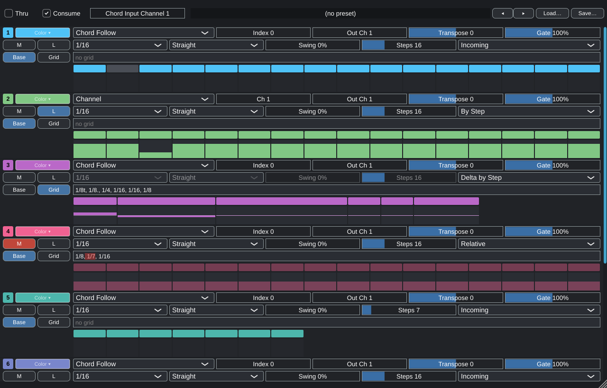

# phu-sequential - User Guide

phu-sequential is a host-synced MIDI arpeggiator sequencer (VST3 MIDI effect). It takes held chords or
single notes as input and plays them through 8 independent step-sequencer lanes, each with its own
rhythm, velocity pattern, gate, transpose and output channel.

---

## Table of Contents

1. [Highlights](#1-highlights)
2. [System Requirements & Installation](#2-system-requirements--installation)
3. [Quick Start](#3-quick-start)
4. [Controls](#4-controls)
5. [Where to Place It](#5-where-to-place-it)
6. [How It Works](#6-how-it-works)
7. [Tips & Typical Workflows](#7-tips--typical-workflows)
8. [Troubleshooting](#8-troubleshooting)
9. [Further Reading](#9-further-reading)

---

## 1. Highlights

- **8 independent lanes** - each lane picks one note out of the held chord (or follows a MIDI channel)
  and plays it with its own rhythm.
- **Chord follow** - held notes are sorted by pitch; a lane plays "index 0" (lowest note), "index 1",
  and so on. Change the chord and every lane follows at its next step.
- **Channel mode** - a lane can instead follow the last note held on any MIDI channel (bass lines,
  melodic sequences).
- **Two timing sources per lane** - a regular *Base* grid (1/32 to 1/1, straight / triplet / dotted,
  with swing) or a free *Grid* text field such as `1/8, 1/16, 1/16, 1/4.` for irregular rhythms.
- **Up to 64 steps per lane** - click to switch steps on or off, drag to set per-step velocity.
- **Four velocity modes** - incoming, by step (absolute), delta by step, relative (percent).
- **Gate, transpose, latch, mute and output channel per lane.**
- **Sample-accurate and host-synced** - follows the host transport, tempo changes, loops and locates.
  No internal clock, no drift.
- **Safe voice handling** - every generated Note-On gets a Note-Off; stopping the transport, bypassing
  or removing the plugin never leaves hanging notes.
- **Pass-through control** - Thru and Consume decide whether your input notes reach the output too.
- **Undo / redo and user presets.**

---

## 2. System Requirements & Installation

| Platform | Architecture | Format(s) | Release file |
|---|---|---|---|
| Windows 10/11 | x64 | VST3 | `phu-sequential-windows-x64-<version>.zip` |
| macOS 11+ | Apple Silicon (arm64) | VST3, AU | `phu-sequential-macos-arm64-<version>.zip` |
| macOS 11+ | Intel (x64) | VST3, AU | `phu-sequential-macos-x64-<version>.zip` |
| Linux | x64 | VST3 | `phu-sequential-linux-x64-<version>.zip` |
| Linux | arm64 | VST3 | `phu-sequential-linux-arm64-<version>.zip` |

Each zip contains the plugin bundle(s) and this guide as `USER_GUIDE.pdf`.

The host must support **MIDI effect plugins** (MIDI in, MIDI out, no audio), e.g. Bitwig Studio,
Cubase, Reaper, Ableton Live (VST3) or Logic Pro (AU MIDI FX).

### Installation

Extract the zip and copy the bundle(s) to the plugin folder of your system:

| Platform | VST3 folder | AU folder |
|---|---|---|
| Windows | `C:\Program Files\Common Files\VST3\` | - |
| macOS | `~/Library/Audio/Plug-Ins/VST3/` | `~/Library/Audio/Plug-Ins/Components/` |
| Linux | `~/.vst3/` | - |

Then let your host rescan its plugins.

**Windows:** requires the
[Visual C++ 2015-2022 Redistributable (x64)](https://aka.ms/vs/17/release/vc_redist.x64.exe).

**macOS:** the builds are not code-signed or notarized. If Gatekeeper blocks the plugin, run
`xattr -dr com.apple.quarantine "<plugin bundle>"` on the extracted bundle.

---

## 3. Quick Start

1. Insert phu-sequential as a **MIDI effect** on an instrument track (in front of the synth), or on a
   MIDI track whose output is routed to an instrument.
2. Play or record a chord on **MIDI channel 1** (the default Chord Input Channel).
3. Press **Play** in the host. phu-sequential only runs while the host transport plays.
4. Lane 1 now plays the lowest chord note as 1/16 notes. All 8 lanes start with the same default
   settings, so all lanes play together on channel 1; mute the lanes you do not need (**M**).
5. Give each lane its own **Index** (0 = lowest chord note, 1 = second lowest, ...), switch steps
   off in the step display, and set a different **Base Timing** or **Grid** to build a pattern.
6. Switch the **Velocity Mode** to *By Step* and drag the step bars to create accents.

---

## 4. Controls

### 4.1 Global Bar

| Control | Range | Default | Description |
|---|---|---|---|
| **Thru** | Off / On | Off | Pass the input notes through to the output in addition to the generated notes. |
| **Consume** | Off / On | On | Never pass through notes on channels that a lane listens to (Chord Input Channel and all lane follow channels), even when Thru is on. Prevents double notes. |
| **Chord Input Channel** | 1 - 16 | 1 | MIDI channel whose held notes form the chord for all chord-follow lanes. |
| **Undo / Redo** | - | - | Undo or redo lane edits (lane parameters, steps, text grids, colors, lane commands). |
| **Preset name** | - | (no preset) | Name of the loaded preset. |
| **Previous / Next arrows** | - | - | Load the previous or next preset in the list. |
| **Load...** | - | - | Choose a preset from the list. |
| **Save...** | - | - | Save the current state as a user preset under a name. |

Non-note events (CC, pitch bend, aftertouch, program change) always pass through unchanged,
regardless of Thru and Consume. The host also offers a **Bypass** parameter: while bypassed, all
input is passed through untouched and the lanes are silent.

### 4.2 Lane Strip

Each of the 8 lane rows has a control strip on the left and the step display on the right.

**Header**

| Control | Description |
|---|---|
| **Lane number / Color** | Lane badge and color picker. The color is used for the lane's steps. |
| **M** (Mute) | Silences the lane. The lane keeps running, so unmuting is always in sync. |
| **L** (Latch) | The lane keeps playing the last chord/note after you release the keys, until new notes arrive. |
| **Base / Grid** | Timing source: regular base timing or the text grid (see 4.4). |
| **Lane commands** | Reverse, Rotate left, Rotate right, Invert, Clear lane, Fill lane. |

**Row 1 - what and where to play**

| Parameter | Range | Default | Description |
|---|---|---|---|
| **Input Mode** | Chord Follow / Channel | Chord Follow | Source of the lane's pitch (see 6.1). |
| **Index** | 0 - 15 | 0 | Chord Follow only: which chord note to play, 0 = lowest. If the chord has fewer notes, the lane is silent. |
| **Ch** | 1 - 16 | 1 | Channel mode only: the MIDI channel the lane follows. |
| **Out Ch** | 1 - 16 | 1 | MIDI channel of the generated notes. |
| **Transpose** | -24 to +24 | 0 | Semitone offset of the generated notes. Notes outside 0 - 127 are skipped. |
| **Gate** | 1 - 200 % | 100 % | Note length relative to the step length. Above 100 % notes overlap the next step (legato). |

**Row 2 - rhythm and dynamics**

| Parameter | Range | Default | Description |
|---|---|---|---|
| **Base Timing** | 1/32, 1/16, 1/8, 1/4, 1/2, 1/1 | 1/16 | Step length (Base source only). |
| **Subdivision** | Straight / Triplet / Dotted | Straight | Multiplies the step length by 1, 2/3 or 3/2 (Base source only). |
| **Swing** | 0 - 100 % | 0 % | Delays every second step by up to half a step (Base source only). |
| **Steps** | 1 - 64 | 16 | Number of steps in the lane's loop. |
| **Velocity Mode** | Incoming / By Step / Delta by Step / Relative | Incoming | How the output velocity is computed (see 4.5). |

Base Timing, Subdivision, Swing and Steps are disabled while the lane uses the Grid source (the text
grid defines the steps). Each source keeps its own settings when you switch.

### 4.3 Step Display

- **Click** a step to switch it on or off. Off steps are rests; the lane keeps advancing.
- **Drag** a step bar vertically to set its value for the selected velocity mode (disabled in
  Incoming mode).
- All lanes share one time scale, so you can compare rhythms between lanes at a glance.
- A position indicator shows the playing step of each lane.

The lane commands act on the steps: **Reverse** reverses the order, **Rotate left / right** shifts the
pattern by one step, **Invert** toggles every step on/off, **Clear lane** switches all steps off and
**Fill lane** switches all steps on. *Fill random*, *Arithmetic sequence* and *Euclidean pattern*
are shown in the menu but not available yet.

### 4.4 Text Grid

With the timing source set to **Grid**, the lane plays the rhythm typed into its text field instead
of a regular base timing. The text grid is a comma-separated list of note values:

- A note value is `1/d` with `d` one of 1, 2, 4, 8, 16, 32, 64.
- Append `t` for a triplet or `.` for a dotted value.
- At most 64 entries. Each entry is one step; the number of entries sets the step count.

Examples:

| Text grid | Rhythm |
|---|---|
| `1/8, 1/8, 1/4` | two eighths and a quarter (one half note in total) |
| `1/8t, 1/8t, 1/8t, 1/4` | eighth-note triplet followed by a quarter |
| `1/4., 1/8` | dotted quarter plus eighth (classic "Charleston") |
| `1/16, 1/16, 1/8, 1/16, 1/16, 1/16, 1/16` | busy funk-style figure |

Invalid input is shown in red and is not applied; the lane keeps its last valid grid. The text field
can be edited while the lane uses the Base source; it takes effect when you switch to Grid.

### 4.5 Velocity Modes

| Mode | Step value range | Default value | Output velocity |
|---|---|---|---|
| **Incoming** | - | - | Velocity of the input note that the lane plays. |
| **By Step** | 0 - 127 | 100 | The step value itself. |
| **Delta by Step** | -127 to +127 | 0 | Input velocity plus the step value. |
| **Relative** | 0 - 200 % | 100 % | Input velocity scaled by the step value. |

Results are limited to 0 - 127. A step whose result is 0 is silent; the lane still advances.

### 4.6 Presets and Undo

- **Save...** stores the complete state (global parameters, all lane parameters, steps, text grids,
  colors) as a user preset file (`*.phuseq`).
- User presets live in the folder `phu/phu-sequential/Presets` inside the user application data
  folder:
  - Windows: `%APPDATA%\phu\phu-sequential\Presets`
  - macOS: `~/Library/phu/phu-sequential/Presets`
  - Linux: `~/.config/phu/phu-sequential/Presets`
- Preset files can be copied between computers and platforms.
- The project state is saved with your host project automatically; no preset is needed for that.
- Factory presets are not included yet.

---

## 5. Where to Place It

phu-sequential is a MIDI effect: put it **before** the instrument that should play the notes.

- **One synth, many lanes:** leave all lanes on Out Ch 1 and insert phu-sequential directly in
  front of the synth.
- **Several synths:** give lanes different **Out Ch** values (e.g. bass lane on channel 2, chord
  lanes on channel 1) and route the plugin's MIDI output to several instrument tracks that filter by
  channel. How to route MIDI between tracks depends on the host.
- **Chords and bass from separate clips:** play chords on the Chord Input Channel and a bass line on
  another channel; set one lane to **Channel** mode following that channel.
- **Hearing the input as well:** switch **Thru** on. Keep **Consume** on if a lane outputs on the same
  channel it listens to, otherwise each note sounds twice.

---

## 6. How It Works

### 6.1 Input

- **Chord Follow:** the held notes on the Chord Input Channel form the chord, sorted ascending by
  pitch. Index 0 is the lowest note. The sustain pedal (CC64) holds notes per channel just like on a
  piano.
- **Channel:** the lane follows the most recently pressed note that is still held on its channel.
- A new pitch is picked up at the **next step start** of the lane, so chord changes always land on
  the lane's grid.
- Releasing the source note stops the lane's note immediately, unless **Latch** is on.

### 6.2 Timing and Transport

- The lanes are locked to the host's musical position (beats). There is no internal clock.
- **Start:** every lane starts at step 1 when the transport starts.
- **Stop:** all generated notes receive a Note-Off immediately.
- Lanes are free-running: rests, missing chord notes or mute do not stop or reset the lane's
  position. Lanes with different lengths drift against each other and realign musically
  (polymeter).
- **Loops and locates:** when the host jumps (loop wrap, moving the playhead), each lane recomputes
  its step from the new position, so the pattern is always where it would be if played from the
  start.
- **Late chords:** hosts sometimes deliver the chord of a new bar one sample after the bar starts
  (typically on a loop wrap). At transport start and at jumps, a lane that has no note waits exactly
  one sample before skipping its first step, so these chords are still played. The lane's grid is
  not shifted.

### 6.3 Live Changes

Parameter, step and text-grid changes take effect glitch-free at the lane's next step start. A note
that is already sounding keeps its length.

### 6.4 Notes and Voices

- **Gate** sets each note's length as a percentage of its step.
- If a note is triggered while the same pitch is still sounding on the same output channel (from any
  lane or from pass-through), the old note is ended first and the new note takes over, so there are
  no stuck or prematurely ended notes.
- Each lane handles up to 32 simultaneous voices.
- Every generated Note-On is guaranteed a matching Note-Off, including on transport stop, bypass,
  preset load and plugin removal.

### 6.5 Swing

Swing delays every second step (2, 4, 6, ...) by up to half a step at 100 %. Swing applies to the
Base timing source only.

---

## 7. Tips & Typical Workflows

- **Classic up-arpeggio:** lanes 1 - 4 with Index 0 - 3, all 1/16, each with only one step in four
  switched on and offset by one step (use *Rotate right*).
- **Bass plus chord stabs:** lane 1 Index 0, Transpose -12, Base 1/8, Out Ch 2 for the bass; lanes 2 - 4
  Index 0 - 2, Base 1/4, Gate 50 % for short stabs.
- **Polyrhythm:** set lanes to 16, 12 and 10 steps; they realign every few bars.
- **Accents:** Velocity Mode *Relative* keeps the dynamics of your playing and adds accents on top.
- **Irregular grooves:** switch a lane to **Grid** and type a rhythm such as
  `1/8., 1/8., 1/8` (tresillo).
- **Hold while editing:** switch **Latch** on so the lanes keep playing while you edit.

---

## 8. Troubleshooting

| Symptom | Cause / Solution |
|---|---|
| No output at all | The host transport must be playing. Check that the input notes arrive on the Chord Input Channel (Chord Follow) or the lane's Ch (Channel mode). |
| A lane is silent | The chord has fewer notes than Index + 1, the lane is muted, all steps are off, or the transposed note is outside 0 - 127. |
| Notes sound twice | Thru is on and a lane outputs on its input channel: switch Consume on. |
| All lanes play the same | That is the default state. Change Index, steps and timing per lane, or mute unused lanes. |
| Plugin not listed in host | Install to the correct folder and rescan; the host must support VST3 MIDI effects (or AU MIDI FX in Logic). |
| Text grid is red | The entry is invalid; see 4.4 for the syntax. |

---

## 9. Further Reading

- [Specification](../spec/README.md) - complete functional specification
- [Architecture](README.md) - design and module documentation
- [README](../README.md) - building from source
- [JUCE framework](https://juce.com/)
- [Steinberg VST3 SDK](https://steinbergmedia.github.io/vst3_dev_portal/)
