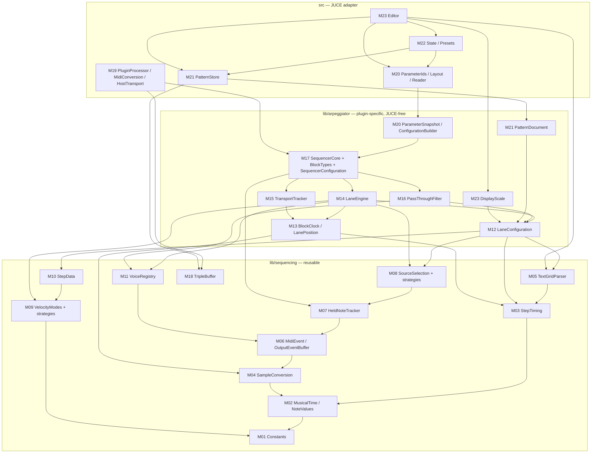
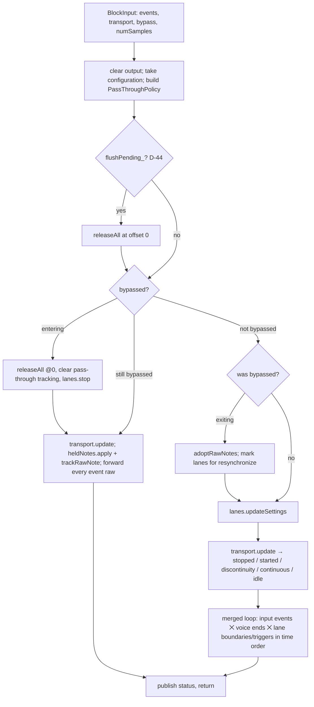

# phu-sequential — Architecture

Status: binding design for issues #3–#16. Source of truth for behavior: `spec/arp-spec.md` (cited as §n). If this document and the spec disagree, **the spec wins**; fix this document in the same PR (see issue template "Processing").

Conventions used here:

- **D-n** = design decision taken where the spec is silent or ambiguous (index in §10). **A-n** = spec ambiguity (list in §12, all decisions provisional until confirmed).
- **[RT]** = callable on the audio thread: `noexcept`, no allocation, no locks, no blocking, no exceptions, O(bounded) (§17).
- **[MT]** = message/UI thread or any non-audio thread only (may allocate/lock).
- Header sketches are normative for names, signatures, ownership and semantics. Private members are indicative; implementers may change them if the public contract and the RT guarantees hold.
- Module IDs `M01`…`M24` are stable and used by `docs/test-matrix.md` (#3) as "owning module".

---

## 1. Layers, directories, namespaces, targets

### 1.1 Layers (§16.1, §16.5, §19) — D-1

| Layer | Directory | Namespace | JUCE? | Content |
|---|---|---|---|---|
| Reusable core | `lib/sequencing/` | `phu::sequencing` | no | constants, musical time, note values, step timing, sample conversion, text-grid parser, MIDI event types, held notes/chord, source strategies, velocity strategies, step data, voice registry, triple buffer |
| Plugin-specific core | `lib/arpeggiator/` | `phu::arpeggiator` | no | lane configuration, lane position, lane engine, transport tracker, pass-through filter, block I/O, sequencer configuration, `SequencerCore`, parameter snapshot → configuration, pattern document, display scale |
| JUCE adapter | `src/` (+ `src/editor/`) | `phu::plugin` (`phu::plugin::editor`) | yes | `AudioProcessor`, MIDI conversion, host transport, parameter layout/reader, pattern store, state/presets, editor |
| Tests | `tests/core/`, `tests/adapter/`, `tests/support/` | `phu::tests` | core: no; adapter: yes | Catch2 v3 |

Dependency rules (enforced by review, and by CMake: `SequentialCoreLib` does not link JUCE):

- `sequencing` depends on nothing but the C++20 standard library.
- `arpeggiator` depends on `sequencing` only.
- `plugin` depends on `arpeggiator`, `sequencing`, JUCE.
- Nothing in `lib/` includes a JUCE header, throws on an [RT] path, uses globals/singletons with mutable state, reads clocks, or uses randomness (§18). The spec contains no random behavior; if any is ever added, it takes an injected, seeded generator.

D-2: `SequentialCoreLib` is a **STATIC** library with `.h/.cpp` pairs (one unit per file, §19), deviating from the template's header-only INTERFACE library because the core is larger and compile times matter. Pure data/constexpr units may be header-only.

### 1.2 Directory layout

```
CMakeLists.txt                      # root (#4)
CMakePresets.json                   # (#4)
cmake/PhuDependencies.cmake         # phu_fetch_juce, phu_fetch_catch2 (#4)
cmake/compiler_flags.cmake          # ENABLE_STRICT_WARNINGS / ENABLE_SANITIZERS / ENABLE_COVERAGE (#4)
cmake/juce_config.cmake             # JUCE feature flags (#4)
scripts/install-linux-deps.sh, scripts/find-cmake.ps1   (#4)
lib/CMakeLists.txt                  # target SequentialCoreLib (#4 creates, later issues add sources)
lib/sequencing/
  Constants.h                       M01 (#5)
  MusicalTime.h                     M02 (#5)
  NoteValues.h                      M02 (#5)
  StepTiming.h / .cpp               M03 (#5)
  SampleConversion.h                M04 (#5)
  TextGridParser.h / .cpp           M05 (#6)
  MidiEvent.h                       M06 (#7)
  OutputEventBuffer.h / .cpp        M06 (#9)
  HeldNoteTracker.h / .cpp          M07 (#7)
  sources/SourceSelection.h / .cpp  M08 (#7)  types, classification, registry lookup
  sources/ChordFollowSource.h/.cpp  M08 (#7)  strategy unit
  sources/ChannelSource.h / .cpp    M08 (#7)  strategy unit
  sources/InputModeRegistry.h       M08 (#7)  the one registration place
  velocity/VelocityMode.h           M09 (#8)  enum + definition type
  velocity/IncomingVelocity.h       M09 (#8)  strategy unit
  velocity/ByStepVelocity.h         M09 (#8)
  velocity/DeltaByStepVelocity.h    M09 (#8)
  velocity/RelativeVelocity.h       M09 (#8)
  velocity/VelocityModeRegistry.h / .cpp  M09 (#8)  the one registration place
  StepData.h / .cpp                 M10 (#8)
  VoiceRegistry.h / .cpp            M11 (#9)
  TripleBuffer.h                    M18 (#12)
lib/arpeggiator/
  LaneConfiguration.h / .cpp        M12 (#10)
  BlockClock.h                      M13 (#10)
  LanePosition.h / .cpp             M13 (#10)
  LaneEngine.h / .cpp               M14 (#10)
  TransportTracker.h / .cpp         M15 (#11)
  PassThroughFilter.h / .cpp        M16 (#11)
  BlockTypes.h                      M17 (#11)
  SequencerConfiguration.h / .cpp   M17 (#11)
  SequencerCore.h / .cpp            M17 (#11)
  ParameterSnapshot.h               M20 (#13)
  ConfigurationBuilder.h / .cpp     M20 (#13)
  PatternDocument.h / .cpp          M21 (#14)
  DisplayScale.h / .cpp             M23 (#15)
src/CMakeLists.txt                  # plugin target phu-sequential (#4)
src/
  PluginProcessor.h / .cpp          M19 (#12)
  MidiConversion.h / .cpp           M19 (#12)
  HostTransport.h / .cpp            M19 (#12)
  PlaybackStatus.h                  M19 (#12)
  ParameterIds.h / .cpp             M20 (#13)
  ParameterLayout.h / .cpp          M20 (#13)
  ParameterReader.h / .cpp          M20 (#13)
  PatternStore.h / .cpp             M21 (#14)
  StateSerializer.h / .cpp          M22 (#14)
  StateMigration.h / .cpp           M22 (#14)
  PresetManager.h / .cpp            M22 (#14)
  editor/PluginEditor.h / .cpp      M23 (#15)
  editor/GlobalBar.h / .cpp         M23 (#15)
  editor/LaneRow.h / .cpp           M23 (#15)
  editor/LaneControlStrip.h / .cpp  M23 (#15)
  editor/StepDisplay.h / .cpp       M23 (#15)
  editor/TextGridField.h / .cpp     M23 (#15)
  editor/LaneColorPicker.h / .cpp   M23 (#15)
  editor/EditorLookAndFeel.h / .cpp M23 (#15)
presets/factory/*.phuseq            M24 (#16)
tests/CMakeLists.txt                # SequentialCoreTests (#4), SequentialAdapterTests (#12)
tests/support/AllocationGuard.h / .cpp   (#11) counts global operator new during a scope
tests/support/ScenarioRunner.h / .cpp    (#11) drives SequencerCore with scripted blocks
tests/core/<Module>Tests.cpp        # one file per module, e.g. StepTimingTests.cpp
tests/adapter/<Unit>Tests.cpp       # MidiConversionTests.cpp, ParameterLayoutTests.cpp, StateSerializerTests.cpp, ...
docs/architecture.md, docs/test-matrix.md (#3), docs/ui/*
```

Include style (template convention): include directory is `lib/`, so `#include "sequencing/StepTiming.h"`, `#include "arpeggiator/LaneEngine.h"`. `src/` files include `"PluginProcessor.h"` relative to `src/`.

### 1.3 Module dependency graph



---

## 2. Units, numeric types, core data types

### 2.1 Units and representation — D-3

| Quantity | Type | Unit | Notes |
|---|---|---|---|
| Musical position / duration (playhead, phase offset, note ends, swing delay) | `Beats` = `double` | quarter-note beats (= host PPQ) | §10, §17: core never stores samples or wall-clock |
| Grid structure (step lengths, step starts in loop, loop length) | `TickCount` = `std::int64_t` | ticks, `ticksPerBeat = 960` | exact: every allowed note length is an integer tick count (1/64 triplet = 40, 1/64 dotted = 90, 1/1 dotted = 5760). No drift when stepping loops. |
| Sample offset inside a block | `SampleOffset` = `std::int32_t` | samples, `[0, numSamples-1]` | computed only at the output boundary (§16.2, §5.4 of this doc) |
| Tempo | `double` | beats per minute | from host, constant within a block |
| Sample rate | `double` | Hz | |
| MIDI channel | `int` in APIs, `std::uint8_t` in events | **1..16** everywhere in the core (never 0-based) | |
| Pitch, velocity, controller | `int` in APIs, `std::uint8_t` in events | 0..127 | |
| Percentages (gate, swing, relative velocity) | `int` | integer percent | D-7 |
| Step index | `int` | 0-based internally; "step 1" in spec = index 0 | |
| Lane index | `int` | 0-based internally (0..7); user-visible / parameter IDs 1-based | |

Conversion of ticks to beats: `beats = ticks / 960.0`. Absolute beat of a step start is always computed as `phaseOffset + (loopIndex * loopLengthTicks + stepStartTicks[k]) / 960.0` (never accumulated), so floating error does not grow over time.

`beatEpsilon = 1.0e-6` beats (≈0.02 samples at 120 BPM/48 kHz) is the only tolerance used for "is exactly at a step start" decisions.

### 2.2 Core data type overview

| Concept | Type | Module |
|---|---|---|
| Event (note on/off, CC, other channel messages, opaque) | `sequencing::MidiEvent` | M06 |
| Output event list | `sequencing::OutputEventBuffer` | M06 |
| Note length (1/d + subdivision) | `sequencing::NoteLength` | M02 |
| Lane grid | `sequencing::GridLayout` | M03 |
| Parsed text grid | `sequencing::TextGrid` | M05 |
| Step data (on/off + value per velocity mode) | `sequencing::StepData`, `sequencing::StepPattern` | M10 |
| Lane configuration (host parameters of one lane) | `arpeggiator::LaneParameters` | M12 |
| Lane non-parameter data seen by audio | `arpeggiator::LanePattern` | M12 |
| Global parameters | `arpeggiator::GlobalParameters` | M12 |
| Full requested configuration | `arpeggiator::SequencerConfiguration` | M17 |
| Block input (events, transport, bypass) | `arpeggiator::BlockInput` (M17), `arpeggiator::TransportInfo` (M15) | M17/M15 |
| Block output | `sequencing::OutputEventBuffer` (filled by `SequencerCore::processBlock`) | M06/M17 |
| Beat ↔ sample mapping of one block | `arpeggiator::BlockClock` | M13 |

---
## 3. Reusable core modules (`lib/sequencing`, namespace `phu::sequencing`)

### 3.1 M01 Constants — `lib/sequencing/Constants.h` (#5)

The single central place for every numeric value (§16.3). No other file may contain a literal for any of these values (tests may). Grouped in nested namespaces; all `inline constexpr`.

```cpp
#pragma once
#include <array>
#include <cstdint>

namespace phu::sequencing::constants {

namespace midi {
inline constexpr int channelCount            = 16;
inline constexpr int firstChannel            = 1;
inline constexpr int lastChannel             = 16;
inline constexpr int lowestPitch             = 0;
inline constexpr int highestPitch            = 127;
inline constexpr int pitchCount              = 128;
inline constexpr int lowestVelocity          = 0;   // §7.2
inline constexpr int highestVelocity         = 127; // §7.2
inline constexpr int noteOffVelocity         = 0;   // §9.1
inline constexpr int sustainPedalController  = 64;  // §3.1
inline constexpr int sustainPedalOnThreshold = 64;  // value >= 64 = on (§3.1)
} // namespace midi

namespace velocity { // §7.1; velocity limits live only in midi:: (§16.3 "exactly one place")
inline constexpr int minimumDelta          = -127;
inline constexpr int maximumDelta          = 127;
inline constexpr int minimumPercent        = 0;
inline constexpr int maximumPercent        = 200;
inline constexpr int percentDivisor        = 100;
inline constexpr int defaultByStepValue    = 100; // D-5
inline constexpr int defaultDeltaValue     = 0;   // D-5
inline constexpr int defaultPercentValue   = 100; // D-5
} // namespace velocity

namespace lanes {
inline constexpr int laneCount               = 8;    // §4
inline constexpr int minimumStepCount        = 1;    // §5.4
inline constexpr int maximumStepCount        = 64;   // §5.4 (also text-grid max entries)
inline constexpr int defaultStepCount        = 16;   // §20
inline constexpr int minimumFollowIndex      = 0;    // §4.2
inline constexpr int maximumFollowIndex      = 15;   // §4.2
inline constexpr int defaultFollowIndex      = 0;    // §20
inline constexpr int defaultFollowChannel    = 1;    // D-33
inline constexpr int defaultOutputChannel    = 1;    // §8, §20
inline constexpr int defaultChordInputChannel= 1;    // §20
inline constexpr int minimumGatePercent      = 1;    // §6
inline constexpr int maximumGatePercent      = 200;  // §6
inline constexpr int defaultGatePercent      = 100;  // §6, §20
inline constexpr int gatePercentDivisor      = 100;  // §6
inline constexpr int minimumTranspose        = -24;  // §8
inline constexpr int maximumTranspose        = 24;   // §8
inline constexpr int defaultTranspose        = 0;    // §20
inline constexpr int minimumSwingPercent     = 0;    // §5.1
inline constexpr int maximumSwingPercent     = 100;  // §5.1
inline constexpr int defaultSwingPercent     = 0;    // §20
inline constexpr int swingPercentToShiftDivisor = 200; // 100 % -> shift = 1/2 step (§5.1)
inline constexpr int maximumVoicesPerLane    = 32;   // §9.4
} // namespace lanes

namespace timing {
struct RationalFactor { int numerator; int denominator; };
inline constexpr std::int64_t ticksPerBeat      = 960;  // D-3
inline constexpr std::int64_t beatsPerWholeNote = 4;
inline constexpr std::int64_t ticksPerWholeNote = ticksPerBeat * beatsPerWholeNote;
inline constexpr RationalFactor straightFactor{1, 1};
inline constexpr RationalFactor tripletFactor{2, 3};   // §16.2
inline constexpr RationalFactor dottedFactor{3, 2};    // §16.2
// Base-timing list (§5.1, §16.2): order = parameter choice order.
inline constexpr std::array<int, 6> baseTimingDenominators{32, 16, 8, 4, 2, 1};
inline constexpr int defaultBaseTimingIndex = 1;       // 1/16 (§20)
// Text grid (§5.2)
inline constexpr int textGridNumerator = 1;
inline constexpr std::array<int, 7> textGridDenominators{1, 2, 4, 8, 16, 32, 64};
inline constexpr int textGridMaximumEntries = 64;
inline constexpr char textGridEntrySeparator = ',';
inline constexpr char textGridFractionSeparator = '/';
inline constexpr char textGridTripletSuffix = 't';
inline constexpr char textGridDottedSuffix = '.';
// Tolerances (D-16)
inline constexpr double beatEpsilon = 1.0e-6;
inline constexpr double playheadJitterToleranceSamples = 1.0;
inline constexpr double sampleRoundingEpsilon = 1.0e-6;
inline constexpr double secondsPerMinute = 60.0;
} // namespace timing

namespace capacity { // D-30, §17
inline constexpr int maximumSoundingVoices   = midi::channelCount * midi::pitchCount; // 2048
inline constexpr int voiceOwnerCount         = lanes::laneCount + 1;                  // lanes + pass-through
inline constexpr int inputEventsPerChunk     = 4096;
inline constexpr int outputEventsPerBlock    = 16384;
inline constexpr int inputEventsPerBlock     = 16384;  // adapter conversion buffer; excess dropped (D-30)
inline constexpr int opaqueEventsPerBlock    = 1024;   // adapter, D-31
inline constexpr int opaqueBytesPerBlock     = 65536;  // adapter, D-31
inline constexpr int outputMidiReserveBytes  = 262144; // adapter MidiBuffer::ensureSize, D-45
} // namespace capacity

namespace colors { // §14, §20; RGB 0xRRGGBB, lane order 1..8 (docs/ui/README.md)
inline constexpr std::array<std::uint32_t, lanes::laneCount> defaultLanePalette{
    0x4FC3F7 /*blue*/, 0x81C784 /*green*/, 0xBA68C8 /*purple*/, 0xF06292 /*pink*/,
    0x4DB6AC /*teal*/, 0x7986CB /*indigo*/, 0xDCE775 /*lime*/,  0xA1887F /*brown*/};
} // namespace colors

namespace editor { // §14; D-36, D-37 (pixels)
inline constexpr int minimumStepDisplayWidth = 16;
inline constexpr int laneRowHeight           = 140;
inline constexpr int globalBarHeight         = 56;
inline constexpr int controlStripWidth       = 148;  // lane control strip (docs/ui sketches)
inline constexpr int defaultWidth            = 1280;
inline constexpr int defaultHeight           = 820;
inline constexpr int minimumWidth            = 1000;
inline constexpr int minimumHeight           = 420;
inline constexpr int maximumWidth            = 3840;
inline constexpr int maximumHeight           = 2400;
inline constexpr int statusRefreshHz         = 30;
} // namespace editor

namespace state { // §13
inline constexpr int currentFormatVersion = 1;
} // namespace state

} // namespace phu::sequencing::constants
```

`static_assert`s in the same header: `ticksPerWholeNote % (64 * 3) == 0` and `(ticksPerWholeNote / 64) % 2 == 0` (all triplet/dotted lengths integral); `defaultLanePalette.size() == laneCount`.

### 3.2 M02 Musical time and note values — `MusicalTime.h`, `NoteValues.h` (#5)

```cpp
// MusicalTime.h
namespace phu::sequencing {
using Beats     = double;        // quarter-note beats (PPQ)
using TickCount = std::int64_t;  // constants::timing::ticksPerBeat per beat
[[nodiscard]] constexpr Beats ticksToBeats(TickCount ticks) noexcept;          // [RT]
[[nodiscard]] constexpr TickCount wholeBeatsToTicks(std::int64_t beats) noexcept; // [RT]
}

// NoteValues.h — data-driven; the only place mapping names <-> factors
namespace phu::sequencing {
enum class Subdivision : std::uint8_t { straight = 0, triplet = 1, dotted = 2 };
inline constexpr int subdivisionCount = 3;

struct SubdivisionDefinition {
    std::string_view name;            // "Straight" / "Triplet" / "Dotted" (parameter choice text)
    std::string_view persistenceKey;  // "straight" / "triplet" / "dotted" (state XML)
    constants::timing::RationalFactor factor;
    char textGridSuffix;              // '\0', 't', '.'
};
inline constexpr std::array<SubdivisionDefinition, subdivisionCount> subdivisionRegistry{{
    {"Straight", "straight", constants::timing::straightFactor, '\0'},
    {"Triplet",  "triplet",  constants::timing::tripletFactor,  constants::timing::textGridTripletSuffix},
    {"Dotted",   "dotted",   constants::timing::dottedFactor,   constants::timing::textGridDottedSuffix},
}};

struct NoteLength {                  // "1/denominator" modified by subdivision
    int denominator = 16;            // power of two, 1..64
    Subdivision subdivision = Subdivision::straight;
    friend constexpr bool operator==(const NoteLength&, const NoteLength&) noexcept = default;
};
// ticksPerWholeNote / denominator * factor.numerator / factor.denominator (exact integer)
[[nodiscard]] constexpr TickCount noteLengthTicks(NoteLength) noexcept;          // [RT]

struct BaseTimingDefinition { std::string_view name; int denominator; };      // name "1/16"
// Built from constants::timing::baseTimingDenominators; index = parameter choice index
[[nodiscard]] constexpr std::span<const BaseTimingDefinition> baseTimingRegistry() noexcept;
[[nodiscard]] constexpr NoteLength baseTimingNoteLength(int baseTimingIndex, Subdivision) noexcept; // index clamped
}
```

### 3.3 M03 Step timing — `StepTiming.h/.cpp` (#5)

Owns the grid model shared by base timing and text grid (§5.1, §5.2, §5.4), swing (§5.1) and gate (§6).

```cpp
namespace phu::sequencing {

struct GridLayout {
    int stepCount = 0;   // 0 = no grid (text grid without valid content, D-9) -> lane silent
    std::array<TickCount, constants::lanes::maximumStepCount>     stepLengthTicks{};
    std::array<TickCount, constants::lanes::maximumStepCount + 1> stepStartTicks{}; // [stepCount] = loop length
    bool swingApplies = false;  // true only for base timing (§5.1 "swing applies only to base timing")

    [[nodiscard]] bool isEmpty() const noexcept { return stepCount == 0; }
    [[nodiscard]] TickCount loopLengthTicks() const noexcept { return stepStartTicks[stepCount]; }
    [[nodiscard]] Beats loopLengthBeats() const noexcept;
    // Equality compares stepCount, swingApplies, and lengths of the first stepCount steps only.
    friend bool operator==(const GridLayout&, const GridLayout&) noexcept;
};

// Base timing (§5.1, §5.4): stepCount clamped to [1, 64]; swingApplies = true.
[[nodiscard]] GridLayout makeUniformGridLayout(NoteLength, int stepCount) noexcept;           // [RT]
// Text grid (§5.2): entries.size() <= 64; empty span -> empty layout; swingApplies = false.
[[nodiscard]] GridLayout makeGridLayout(std::span<const NoteLength> entries) noexcept;        // [RT]

// Swing (§5.1): delay (D-4) of steps with odd 0-based index; never step 0 of a loop.
// delay = stepLength * swingPercent / 200; 0 if !swingApplies or index even. swingPercent clamped [0,100].
[[nodiscard]] Beats swingDelayBeats(TickCount stepLengthTicks, int stepIndexInLoop,
                                    int swingPercent, bool swingApplies) noexcept;            // [RT]
// Gate (§6): stepLength * gatePercent / 100, gatePercent clamped [1,200]. Always > 0.
[[nodiscard]] Beats gatedLengthBeats(TickCount stepLengthTicks, int gatePercent) noexcept;    // [RT]
// Index of the step containing tick position p in [0, loopLength): largest k with start[k] <= p.
[[nodiscard]] int stepIndexAtTick(const GridLayout&, TickCount positionInLoop) noexcept;      // [RT], binary search
}
```

Rules: swing is a function of the step index **within the loop** (counting restarts at each loop, §5.1); with an odd step count the loop's last step (even 0-based index) is unswung and step 0 of the next loop is never shifted. Swing never changes `stepStartTicks` (grid positions unchanged; also not in display, §14).

### 3.4 M04 Sample conversion — `SampleConversion.h` (#5)

The single beats→samples boundary (§10, §16.2, §17). Pure, header-only.

```cpp
namespace phu::sequencing {
using SampleOffset = std::int32_t;

// sampleRate * 60 / bpm; returns 0 if bpm <= 0 or sampleRate <= 0 (caller treats as "no clock").
[[nodiscard]] constexpr double samplesPerBeat(double tempoBeatsPerMinute, double sampleRate) noexcept; // [RT]
[[nodiscard]] constexpr double beatsToSamples(Beats duration, double samplesPerBeat) noexcept;         // [RT]
[[nodiscard]] constexpr Beats  samplesToBeats(double samples, double samplesPerBeat) noexcept;         // [RT]
// D-15: floor((beat - blockStartBeat) * samplesPerBeat + sampleRoundingEpsilon), clamped to [0, numSamples-1]
// (returns 0 when numSamples <= 0).
[[nodiscard]] SampleOffset beatToSampleOffset(Beats beat, Beats blockStartBeat,
                                              double samplesPerBeat, int numSamples) noexcept;         // [RT]
}
```

### 3.5 M05 Text-grid parser — `TextGridParser.h/.cpp` (#6)

Runs on the message thread (may allocate for error lists); the *result* type `TextGrid` is fixed-capacity so it can travel to the audio thread.

```cpp
namespace phu::sequencing {

struct TextGrid {                                    // a VALID grid only
    int entryCount = 0;                              // 0..64; 0 = "no grid" (D-9)
    std::array<NoteLength, constants::timing::textGridMaximumEntries> entries{};
    [[nodiscard]] std::span<const NoteLength> activeEntries() const noexcept;
    friend bool operator==(const TextGrid&, const TextGrid&) noexcept; // first entryCount entries
};

enum class TextGridErrorReason : std::uint8_t {
    emptyText,           // whole text empty / whitespace only
    emptyEntry,          // ",," or trailing ","
    malformedEntry,      // not "<num>/<den>[suffix]"
    invalidNumerator,    // numerator token != "1"
    invalidDenominator,  // not one of 1,2,4,8,16,32,64
    unknownSuffix,       // suffix other than 't' or '.'
    conflictingSuffixes, // both / repeated suffixes, e.g. "1/8t." or "1/8tt"
    tooManyEntries       // entry index >= 64
};
struct TextGridError {
    int entryIndex;                 // 0-based entry index (0 for emptyText)
    std::size_t textBegin;          // byte range in the original text, for red marking (§5.3)
    std::size_t textEnd;            // exclusive
    TextGridErrorReason reason;
};
struct TextGridParseResult {
    std::optional<TextGrid> grid;          // set iff errors.empty()
    std::vector<TextGridError> errors;     // every invalid entry, ascending entryIndex
    [[nodiscard]] bool isValid() const noexcept { return grid.has_value(); }
};

[[nodiscard]] TextGridParseResult parseTextGrid(std::string_view text);   // [MT]
[[nodiscard]] std::string formatTextGrid(const TextGrid&);                // [MT] canonical "1/8t, 1/8., 1/4"
}
```

Grammar (D-8): `text := entry (',' entry)*`; `entry := ws* "1" "/" den suffix? ws*`; `den ∈ {"1","2","4","8","16","32","64"}` (exact tokens: no sign, no leading zeros, no inner whitespace); `suffix := 't' | '.'` (lowercase `t` only); `ws` = ASCII space or tab. A grid with any error is rejected as a whole (§5.3). `formatTextGrid(parse(x).grid)` re-parses to the same grid.

### 3.6 M06 MIDI events and output buffer — `MidiEvent.h` (#7), `OutputEventBuffer.h/.cpp` (#9)

```cpp
namespace phu::sequencing {

enum class MidiEventKind : std::uint8_t {
    noteOn,          // data1 = pitch, data2 = velocity (0 allowed on INPUT; normalized by consumers, §3.1)
    noteOff,         // data1 = pitch, data2 = release velocity
    controlChange,   // data1 = controller, data2 = value
    channelMessage,  // any other <=3-byte channel voice message (pitch bend, aftertouch, program change):
                     // status byte in `status`, data bytes in data1/data2, size in `size`
    opaque           // anything else (SysEx, meta, realtime, >3 bytes): carried by handle (D-31)
};

struct MidiEvent {
    SampleOffset sampleOffset = 0;
    MidiEventKind kind = MidiEventKind::opaque;
    std::uint8_t channel = 0;        // 1..16 for channel messages, 0 for opaque
    std::uint8_t data1 = 0;
    std::uint8_t data2 = 0;
    std::uint8_t status = 0;         // raw status byte (channelMessage only)
    std::uint8_t size = 0;           // byte count (channelMessage only)
    std::uint32_t opaqueHandle = 0;  // adapter-defined index (opaque only); core copies it verbatim

    [[nodiscard]] constexpr bool isNoteOnWithVelocity() const noexcept;  // noteOn && data2 > 0
    [[nodiscard]] constexpr bool isNoteRelease() const noexcept;         // noteOff || (noteOn && data2 == 0)
    friend constexpr bool operator==(const MidiEvent&, const MidiEvent&) noexcept = default;
};
[[nodiscard]] constexpr MidiEvent makeNoteOn(SampleOffset, int channel, int pitch, int velocity) noexcept;
[[nodiscard]] constexpr MidiEvent makeNoteOff(SampleOffset, int channel, int pitch) noexcept; // velocity 0 (§9.1)
// Note-On with velocity 0 -> noteOff kind (release velocity 0); other events unchanged (D-26).
[[nodiscard]] constexpr MidiEvent normalizeNoteEvent(const MidiEvent&) noexcept;

class OutputEventBuffer {                         // D-30
public:
    explicit OutputEventBuffer(std::size_t capacity = constants::capacity::outputEventsPerBlock); // [MT] allocates once
    void clear() noexcept;                                                    // [RT]
    // Note-Offs: always accepted while size() < capacity(); returns false only on hard overflow (asserted).
    bool pushNoteOff(const MidiEvent&) noexcept;                              // [RT]
    // Note-Ons / other events: accepted only if free slots after the push still cover
    // `soundingVoiceCount + 1` future Note-Offs; otherwise dropped and counted.
    [[nodiscard]] bool tryPushNoteOn(const MidiEvent&, int soundingVoiceCount) noexcept; // [RT]
    [[nodiscard]] bool tryPushOther(const MidiEvent&, int soundingVoiceCount) noexcept;  // [RT]
    [[nodiscard]] std::span<const MidiEvent> events() const noexcept;         // non-decreasing sampleOffset
    [[nodiscard]] std::size_t size() const noexcept;
    [[nodiscard]] std::size_t capacity() const noexcept;
    [[nodiscard]] std::uint32_t droppedEventCount() const noexcept;           // since construction
private:
    std::vector<MidiEvent> storage_;  // sized in constructor, never resized
    std::size_t used_ = 0;
    std::uint32_t dropped_ = 0;
};
}
```

Invariant (relied on by M17): output events are appended in processing order, which is chronological, so `events()` is sorted by `sampleOffset` (non-decreasing); same-offset order is meaningful (§5.3 of this doc) and must be preserved by the adapter.

### 3.7 M07 Held-note tracker — `HeldNoteTracker.h/.cpp` (#7)

Live held-note state for all 16 channels (§3.1, §3.2, §4.3, §10 "sources always reflect the live held-note state"). Tracks every channel, so changing the chord input channel or a follow channel takes effect on already-held keys.

```cpp
namespace phu::sequencing {

struct HeldNote { std::uint8_t pitch; std::uint8_t velocity; 
                  friend constexpr bool operator==(const HeldNote&, const HeldNote&) noexcept = default; };

class HeldNoteTracker {
public:
    void reset() noexcept;                                                        // [RT] nothing held, pedals up
    // Applies Note-On (v>0), Note-Off / Note-On v=0, CC64. Other events: ignored, returns false.
    // Returns true iff the held set or the most-recent note of the event's channel changed.
    bool apply(const MidiEvent& event) noexcept;                                  // [RT] O(1)
    [[nodiscard]] bool isHeld(int channel, int pitch) const noexcept;             // key down OR sustained
    [[nodiscard]] int heldCount(int channel) const noexcept;
    // Sorted ascending by pitch, index 0 = lowest (§3.4); nullopt if index >= heldCount.
    [[nodiscard]] std::optional<HeldNote> heldNoteAtIndex(int channel, int sortedIndex) const noexcept; // O(128)
    // Most recent Note-On on the channel, only while that pitch is still held (no note stack, §4.3).
    [[nodiscard]] std::optional<HeldNote> mostRecentNote(int channel) const noexcept;
    [[nodiscard]] bool isSustainPedalDown(int channel) const noexcept;
private:
    struct ChannelState {
        std::bitset<constants::midi::pitchCount> keyDown;
        std::bitset<constants::midi::pitchCount> sustained;   // released while pedal down
        std::array<std::uint8_t, constants::midi::pitchCount> velocity{};
        int mostRecentPitch = -1;
        bool pedalDown = false;
    };
    std::array<ChannelState, constants::midi::channelCount> channels_{};
};
}
```

Rules: Note-On(p,v>0): `keyDown[p]=1`, `velocity[p]=v` (replaces, one entry per pitch), `mostRecentPitch=p`. Release(p): `keyDown[p]=0`; if pedal down `sustained[p]=1`. CC64 ≥ 64: pedal down. CC64 < 64: pedal up, `sustained` cleared (notes not key-held leave). Held = `keyDown | sustained`. Out-of-range channel/pitch in events: ignored (§17 validation).

### 3.8 M08 Source selection (input modes as strategies) — `sources/*` (#7)

"Index determination" (§16.1, §16.4) is the per-input-mode strategy that turns held notes into a lane's source note. One unit per mode; one registry.

```cpp
// sources/SourceSelection.h
namespace phu::sequencing {
enum class InputMode : std::uint8_t { chordFollow = 0, channel = 1 };   // order == registry order
inline constexpr int inputModeCount = 2;

struct SourceSelector {                 // committed lane selection + global chord channel
    InputMode inputMode = InputMode::chordFollow;
    int followIndex = constants::lanes::defaultFollowIndex;          // chordFollow
    int followChannel = constants::lanes::defaultFollowChannel;      // channel
    int chordInputChannel = constants::lanes::defaultChordInputChannel; // global (§3.2)
    friend constexpr bool operator==(const SourceSelector&, const SourceSelector&) noexcept = default;
};
using SourceNote = HeldNote;            // pitch + velocity of the followed input note

using SelectSourceFunction = std::optional<SourceNote> (*)(const HeldNoteTracker&, const SourceSelector&) noexcept;
struct InputModeDefinition {
    std::string_view name;              // parameter choice text: "Chord Follow", "Channel"
    std::string_view persistenceKey;    // "chordFollow", "channel"
    SelectSourceFunction select;
};

[[nodiscard]] std::optional<SourceNote> selectSource(const HeldNoteTracker&, const SourceSelector&) noexcept; // [RT] registry lookup

enum class SourceChange : std::uint8_t { unchanged, started, pitchChanged, released };
// none->none: unchanged; none->note: started; note->none: released (§4.4, §9.2);
// note->note with different pitch: pitchChanged (re-sorting or new note, §4.2/§4.4); same pitch: unchanged.
[[nodiscard]] constexpr SourceChange classifySourceChange(std::optional<SourceNote> previous,
                                                          std::optional<SourceNote> current) noexcept; // [RT]
}
// sources/ChordFollowSource.h — heldNoteAtIndex(chordInputChannel, followIndex) (§4.2)
[[nodiscard]] std::optional<SourceNote> selectChordFollowSource(const HeldNoteTracker&, const SourceSelector&) noexcept;
// sources/ChannelSource.h — mostRecentNote(followChannel) (§4.3)
[[nodiscard]] std::optional<SourceNote> selectChannelSource(const HeldNoteTracker&, const SourceSelector&) noexcept;
// sources/InputModeRegistry.h — THE registration place (§16.4)
inline constexpr std::array<InputModeDefinition, inputModeCount> inputModeRegistry{{
    {"Chord Follow", "chordFollow", &selectChordFollowSource},
    {"Channel",      "channel",     &selectChannelSource},
}};
```

Adding a mode = new unit file + one registry line + one enum value; parameter choices, state keys and UI lists are derived from the registry (no `switch` over modes anywhere).

### 3.9 M09 Velocity modes (strategies) — `velocity/*` (#8)

```cpp
// velocity/VelocityMode.h
namespace phu::sequencing {
enum class VelocityMode : std::uint8_t { incoming = 0, byStep = 1, deltaByStep = 2, relative = 3 }; // == registry order
inline constexpr int velocityModeCount = 4;

struct StepValueRange { int minimum; int maximum; int defaultValue; };
// Returns the UNCLAMPED velocity; clamping/zero handling is common code (§7.2).
using ComputeVelocityFunction = int (*)(int stepValue, int inputVelocity) noexcept;
struct VelocityModeDefinition {
    std::string_view name;            // "Incoming", "By Step", "Delta by Step", "Relative" (choice text)
    std::string_view persistenceKey;  // "incoming", "byStep", "deltaByStep", "relative"
    bool usesStepValues;              // false for incoming (§7.1; drag bars disabled, §14)
    StepValueRange stepValueRange;    // drives clamping, defaults, UI drag range
    ComputeVelocityFunction compute;
};
}
// velocity/IncomingVelocity.h      compute = inputVelocity                         range {0,0,0}, usesStepValues=false
// velocity/ByStepVelocity.h        compute = stepValue                             range {0,127,100}
// velocity/DeltaByStepVelocity.h   compute = inputVelocity + stepValue             range {-127,127,0}
// velocity/RelativeVelocity.h      compute = (inputVelocity*stepValue + 50) / 100  range {0,200,100}  (D-6)
// velocity/VelocityModeRegistry.h
namespace phu::sequencing {
extern const std::array<VelocityModeDefinition, velocityModeCount> velocityModeRegistry; // or inline constexpr
[[nodiscard]] const VelocityModeDefinition& velocityModeDefinition(VelocityMode) noexcept;     // [RT]
[[nodiscard]] int clampStepValue(VelocityMode, int value) noexcept;                             // [RT]
// clamp(compute(...), 0, 127); 0 -> nullopt ("not sent", §7.2); else 1..127.
[[nodiscard]] std::optional<std::uint8_t> computeOutputVelocity(VelocityMode, int stepValue, int inputVelocity) noexcept; // [RT]
}
```

All ranges reference `constants::velocity` / `constants::midi` (no literals). Mode enum out of range → treated as `incoming` via clamped index (§17).

### 3.10 M10 Step data — `StepData.h/.cpp` (#8)

One array per lane, shared by both timing sources (§5.2), fixed capacity 64, values stored per velocity mode (§7).

```cpp
namespace phu::sequencing {
struct StepData {
    bool enabled = true;                                           // §5.4/§20: new steps are on
    std::array<std::int16_t, velocityModeCount> valueByMode{};     // indexed by VelocityMode; incoming slot unused (0)
    friend constexpr bool operator==(const StepData&, const StepData&) noexcept = default;
};
[[nodiscard]] constexpr StepData defaultStepData() noexcept;       // enabled, each mode's defaultValue

class StepPattern {
public:
    StepPattern() noexcept;                                         // 64 x defaultStepData()
    [[nodiscard]] const StepData& step(int index) const noexcept;   // index clamped [0,63]
    void setEnabled(int index, bool enabled) noexcept;              // out-of-range index ignored
    void setValue(int index, VelocityMode, int value) noexcept;     // clampStepValue; incoming ignored
    // Positional transfer (§5.2, §5.4): data at index i stays at i; steps >= newCount reset to defaults
    // when newCount < oldCount ("discarded, not restored"); new steps already hold defaults (invariant).
    void applyStepCountChange(int oldCount, int newCount) noexcept;
    friend bool operator==(const StepPattern&, const StepPattern&) noexcept = default;
private:
    std::array<StepData, constants::lanes::maximumStepCount> steps_;
};
}
```

Invariant **I-1**: every slot at index ≥ the lane's effective step count holds `defaultStepData()`. Hence "increase" needs no action, and "decrease" resets the tail. Maintained by `PatternDocument` (M21), see D-32.

### 3.11 M11 Voice registry — `VoiceRegistry.h/.cpp` (#9)

Central ownership of every sounding output note, across all lanes and pass-through (§9.1, §9.3, §9.4, §3.3). At most one sounding voice per (output channel, pitch) — guaranteed by the retrigger policy — so storage is a fixed 16×128 slot table.

```cpp
namespace phu::sequencing {
using VoiceId = std::uint32_t;                 // unique, monotonically increasing; 0 = invalid; wraps skipping 0
inline constexpr VoiceId invalidVoiceId = 0;
using OwnerId = std::uint8_t;                  // arpeggiator: lanes 0..7, pass-through = laneCount (8)
inline constexpr Beats noScheduledEnd = std::numeric_limits<Beats>::infinity();

struct VoiceStartRequest {
    OwnerId owner;
    int channel;                               // 1..16 (output channel)
    int pitch;                                 // 0..127 (already transposed and range-checked by caller)
    int velocity;                              // 1..127
    Beats scheduledEndBeat = noScheduledEnd;   // lanes: absolute beat of Note-Off; pass-through: none
};
struct VoiceHandle {                           // returned by startVoice; identifies one voice instance
    VoiceId id = invalidVoiceId;
    std::uint16_t slot = 0;                    // (channel-1)*128 + pitch
    [[nodiscard]] constexpr bool isValid() const noexcept { return id != invalidVoiceId; }
};
struct ScheduledVoiceEnd { Beats beat; VoiceHandle voice; };

class VoiceRegistry {
public:
    VoiceRegistry() noexcept;                                            // no voices, all owners unlimited
    void reset() noexcept;                                               // [RT] forget all WITHOUT emitting (used only after a flush)
    void setVoiceLimit(OwnerId, int maximumVoices) noexcept;             // 0 = unlimited; lanes: 32 (§9.4)
    // Emits, in this order (D-29): (1) Note-Off of the voice currently sounding on (channel,pitch), ownership
    // transferred (§9.1); (2) if owner still at its limit: Note-Off of the owner's OLDEST voice (§9.4);
    // (3) Note-On. Returns an invalid handle (and emits nothing) if the output buffer refuses the Note-On.
    [[nodiscard]] VoiceHandle startVoice(const VoiceStartRequest&, SampleOffset, OutputEventBuffer&) noexcept; // [RT]
    // Registers a note already sounding downstream (bypass exit, D-27); emits nothing; same eviction rules.
    [[nodiscard]] VoiceHandle adoptVoice(const VoiceStartRequest&) noexcept;                                   // [RT]
    // Emits Note-Off (velocity 0) iff the voice is still sounding and owned; otherwise suppressed (§9.1). 
    bool endVoice(VoiceHandle, SampleOffset, OutputEventBuffer&) noexcept;                                     // [RT]
    int releaseOwner(OwnerId, SampleOffset, OutputEventBuffer&) noexcept;    // all voices of owner, oldest first
    int releaseAll(SampleOffset, OutputEventBuffer&) noexcept;               // all voices, oldest first
    // Earliest finite scheduledEndBeat; ties -> smaller VoiceId (older) first.
    [[nodiscard]] std::optional<ScheduledVoiceEnd> nextScheduledEnd() const noexcept;                     // [RT] O(sounding)
    [[nodiscard]] bool isSounding(VoiceHandle) const noexcept;
    [[nodiscard]] int soundingCount() const noexcept;
    [[nodiscard]] int soundingCount(OwnerId) const noexcept;
    [[nodiscard]] std::optional<OwnerId> ownerOf(int channel, int pitch) const noexcept;
private:
    struct Slot { VoiceId id = invalidVoiceId; OwnerId owner = 0; Beats endBeat = noScheduledEnd;
                  std::uint16_t previousInOwner, nextInOwner, previousGlobal, nextGlobal; };
    std::array<Slot, constants::capacity::maximumSoundingVoices> slots_;   // index = (channel-1)*128 + pitch
    // intrusive lists (start order) per owner and global; per-owner counts and limits
    std::array<std::uint16_t, constants::capacity::voiceOwnerCount> ownerHead_, ownerTail_;
    std::array<int, constants::capacity::voiceOwnerCount> ownerCount_{}, ownerLimit_{};
    std::uint16_t globalHead_, globalTail_;
    VoiceId nextVoiceId_ = 1;
    int soundingCount_ = 0;
};
}
```

`VoiceHandle` makes `endVoice`/`isSounding` O(1): the slot index is `(channel-1)*128 + pitch`; a handle is stale (→ suppressed) iff `slots_[slot].id != handle.id`. Owner ids ≥ `voiceOwnerCount`, channels/pitches out of range are rejected (§17).

### 3.12 M18 Triple buffer — `TripleBuffer.h` (#12)

Wait-free single-producer/single-consumer "latest value" hand-off (§17). Used for pattern data (message → audio) and playback status (audio → message). Header-only template; `T` must be trivially copyable or at least nothrow-copy-assignable without allocation.

```cpp
namespace phu::sequencing {
template <typename T>
class TripleBuffer {
public:
    TripleBuffer() = default;                         // three value-initialized T (allocated with the owner)
    explicit TripleBuffer(const T& initial);          // all three slots = initial
    // Producer side (exactly one thread at a time; PatternStore serializes producers with its mutex).
    [[nodiscard]] T& writeBuffer() noexcept;          // fill in place, then publish()
    void publish() noexcept;                          // swaps back<->middle, sets "fresh" bit (release)
    void write(const T& value) noexcept { writeBuffer() = value; publish(); }
    // Consumer side (exactly one thread). Returns true if a newer value was taken.
    bool update() noexcept;                           // swaps front<->middle if fresh (acq_rel)
    [[nodiscard]] const T& read() const noexcept;     // current front, stable until next update()
private:
    std::array<T, 3> slots_{};
    std::atomic<std::uint8_t> middleAndFresh_{1};     // bits 0-1 middle index, bit 2 fresh
    std::uint8_t backIndex_ = 0, frontIndex_ = 2;
    static_assert(std::atomic<std::uint8_t>::is_always_lock_free);
};
}
```

All operations are [RT] (`noexcept`, O(1), no allocation, a single atomic exchange).

---

## 4. Plugin-specific core (`lib/arpeggiator`, namespace `phu::arpeggiator`)

### 4.1 M12 Lane configuration — `LaneConfiguration.h/.cpp` (#10)

```cpp
namespace phu::arpeggiator {
using namespace phu::sequencing; // (sketch only; real headers use qualified names)

enum class TimingSource : std::uint8_t { baseTiming = 0, textGrid = 1 };    // §5.2
inline constexpr int timingSourceCount = 2;
struct TimingSourceDefinition { std::string_view name; std::string_view persistenceKey; };
inline constexpr std::array<TimingSourceDefinition, timingSourceCount> timingSourceRegistry{{
    {"Base Timing", "baseTiming"}, {"Text Grid", "textGrid"}}};

// Host parameters of one lane (§12), already validated (see clampLaneParameters). Defaults = §20.
struct LaneParameters {
    bool mute = false;
    bool latch = false;
    InputMode inputMode = InputMode::chordFollow;
    int followIndex = constants::lanes::defaultFollowIndex;       // 0..15
    int followChannel = constants::lanes::defaultFollowChannel;   // 1..16
    int outputChannel = constants::lanes::defaultOutputChannel;   // 1..16
    int transpose = constants::lanes::defaultTranspose;           // -24..24
    int gatePercent = constants::lanes::defaultGatePercent;       // 1..200
    TimingSource timingSource = TimingSource::baseTiming;
    int baseTimingIndex = constants::timing::defaultBaseTimingIndex; // 0..5 into baseTimingRegistry
    Subdivision subdivision = Subdivision::straight;
    int swingPercent = constants::lanes::defaultSwingPercent;     // 0..100
    int stepCount = constants::lanes::defaultStepCount;           // 1..64 (base timing only)
    VelocityMode velocityMode = VelocityMode::incoming;
    friend constexpr bool operator==(const LaneParameters&, const LaneParameters&) noexcept = default;
};

struct GlobalParameters {                 // global host parameters (§3.2, §3.3, §12); used by M16 and M17
    bool thru = false;                                                      // §3.3, §20
    bool consume = true;                                                    // §3.3, §20
    int chordInputChannel = constants::lanes::defaultChordInputChannel;     // 1..16, §3.2
    friend constexpr bool operator==(const GlobalParameters&, const GlobalParameters&) noexcept = default;
};

// Non-parameter lane data the audio thread needs (§12, §13). Lane color is NOT here (UI/state only).
struct LanePattern {
    StepPattern steps;
    TextGrid appliedTextGrid;            // last valid grid (§5.3); entryCount 0 = none (D-9)
    friend bool operator==(const LanePattern&, const LanePattern&) noexcept = default;
};

[[nodiscard]] LaneParameters clampLaneParameters(const LaneParameters&) noexcept;                // [RT] §17
// Grid of the ACTIVE timing source: base -> makeUniformGridLayout(baseTimingNoteLength(..), stepCount);
// textGrid -> makeGridLayout(appliedTextGrid.activeEntries()). Data-driven via a 2-entry function table.
[[nodiscard]] GridLayout makeActiveGridLayout(const LaneParameters&, const TextGrid& appliedTextGrid) noexcept; // [RT]
[[nodiscard]] int effectiveStepCount(const LaneParameters&, const TextGrid& appliedTextGrid) noexcept;          // [RT]
[[nodiscard]] SourceSelector makeSourceSelector(const LaneParameters&, int chordInputChannel) noexcept;        // [RT]
}
```

Change classes per field (§4.4, §4.6, §11), used by `LaneEngine::updateSettings`:

| Class | Fields | Takes effect |
|---|---|---|
| Immediate | `mute`, `latch` | at the block start where the new value is seen (D-21): mute on / latch on→off release lane voices and clear latch memory (§4.6) |
| Next step start — selector | `inputMode`, `followIndex`, `followChannel` | at the next step boundary (§4.4, §11); release of the committed source still stops immediately |
| Next step start — grid (D-10) | `timingSource`, `baseTimingIndex`, `subdivision`, `stepCount`, `appliedTextGrid` | the derived `GridLayout` is compared; if different → pending; committed at the next step boundary with re-anchoring (§5.4, D-11) |
| At trigger (newly triggered notes) | `outputChannel`, `transpose`, `gatePercent`, `velocityMode`, step data | read when a step triggers (§11, §7) |
| At boundary | `swingPercent` | read when the step's trigger time is computed at its boundary (§11 "affects newly triggered notes") |
| Global, immediate | `chordInputChannel` | chord redefined at block start; lanes re-classify their source (D-24) |

### 4.2 M13 Block clock and lane position — `BlockClock.h`, `LanePosition.h/.cpp` (#10)

```cpp
namespace phu::arpeggiator {
struct BlockClock {                       // beat <-> sample mapping of the current block
    Beats blockStartBeat = 0;             // host playhead at sample 0
    Beats windowStartBeat = 0;            // first beat processed (D-16; == blockStartBeat unless continuous jitter)
    Beats windowEndBeat = 0;              // exclusive: blockStartBeat + numSamples / samplesPerBeat
    double samplesPerBeat = 0;
    int numSamples = 0;
    [[nodiscard]] SampleOffset toSampleOffset(Beats beat) const noexcept;   // beatToSampleOffset(beat, blockStartBeat, ...)
    [[nodiscard]] Beats toBeat(SampleOffset offset) const noexcept;         // blockStartBeat + offset / samplesPerBeat
    [[nodiscard]] bool contains(Beats beat) const noexcept;                 // windowStartBeat <= beat < windowEndBeat
};

struct LanePosition {
    std::int64_t loopIndex;   // floor((playhead - phaseOffset) / loopLength)
    int stepIndex;            // step containing the playhead
    bool isAtStepStart;       // |playhead - start(stepIndex)| <= beatEpsilon
};
// §10: position = (playhead - phaseOffset) mod loopLength. Precondition: !layout.isEmpty().
[[nodiscard]] LanePosition derivePosition(Beats playheadBeat, Beats phaseOffsetBeat, const GridLayout&) noexcept;   // [RT]
// Absolute beat of a step start: phaseOffset + (loopIndex*loopLengthTicks + stepStartTicks[stepIndex]) / ticksPerBeat
[[nodiscard]] Beats stepStartBeat(Beats phaseOffsetBeat, std::int64_t loopIndex, int stepIndex, const GridLayout&) noexcept;
// §5.4 re-anchoring (D-11): returns phaseOffset such that step `newStepIndex` of newLayout (loopIndex 0) starts at commitBeat.
[[nodiscard]] Beats reanchorPhaseOffset(Beats commitBeat, int newStepIndex, const GridLayout& newLayout) noexcept;
}
```

### 4.3 M14 Lane engine — `LaneEngine.h/.cpp` (#10)

One lane: commits pending changes at step boundaries, triggers notes, reacts to source changes. It owns no voices; it starts/ends them through `VoiceRegistry` with its `OwnerId` (= lane index).

```cpp
namespace phu::arpeggiator {

struct LaneContext {                       // per-call services, all non-owning
    VoiceRegistry& voices;
    OutputEventBuffer& output;
    const HeldNoteTracker& heldNotes;
    const BlockClock& clock;
    int chordInputChannel;                 // current global value (D-24)
};

struct LaneStatus {                        // published to the editor (M19 PlaybackStatus)
    int currentStepIndex = -1;             // step whose boundary was last passed; -1 = not running / no grid
    int activeStepCount = 0;               // committed grid
    bool isRunning = false;
    bool hasLatchedNote = false;
};

class LaneEngine {
public:
    explicit LaneEngine(OwnerId owner) noexcept;           // owner = lane index 0..7
    void reset() noexcept;                                  // §20 defaults, stopped, no latch memory, nothing pending

    // Once per block, BEFORE transitions and timeline (§5.2 step 3 of this doc). `pattern` must stay valid until the next
    // call (SequencerCore owns it). Applies the change classes of 4.1 at clock.windowStartBeat / offset 0.
    // The lane writes to `pattern` only to discard the step tail when a committed effective step count decreases (I-1).
    void updateSettings(const LaneParameters&, LanePattern& pattern, LaneContext&) noexcept;

    void anchorTransportStart(Beats playheadBeat) noexcept; // phaseOffset = playhead, loopIndex 0, step 0 (§10); not running
    void startTransport(Beats playheadBeat) noexcept;       // anchor + running; boundary of step 0 at playhead
    // Transport stop / bypass enter (§10, §21): release lane voices at `offset`, clear latch memory,
    // commit all pending changes WITHOUT re-anchoring (D-18), running = false. Phase offset kept.
    void stop(SampleOffset offset, LaneContext&) noexcept;
    // Discontinuity (§10) / bypass exit (§21) / grid becoming non-empty (D-9): if releaseVoices, release lane
    // voices at `offset`; commit pending WITHOUT re-anchoring (D-19); derive position from playheadBeat;
    // next boundary = current step start if isAtStepStart, else next step start (D-13); running = true.
    void resynchronize(Beats playheadBeat, SampleOffset offset, bool releaseVoices, LaneContext&) noexcept;

    // After each input event that changed held notes (and after a chord-channel change), at that event's offset.
    void onHeldNotesChanged(SampleOffset offset, LaneContext&) noexcept;

    [[nodiscard]] Beats nextTimelineBeat() const noexcept;  // min(pending trigger, next boundary); +inf if none
    void processNextTimelineEvent(LaneContext&) noexcept;   // exactly one boundary or trigger at nextTimelineBeat()
    [[nodiscard]] LaneStatus status() const noexcept;
    // Lowest step index discarded since the last call (constants::lanes::maximumStepCount = none); resets.
    [[nodiscard]] int takeDiscardedFromStep() noexcept;

private:
    OwnerId owner_;
    LanePattern* pattern_ = nullptr;
    int discardedFromStep_ = constants::lanes::maximumStepCount;
    LaneParameters requested_{};                 // latest parameters
    SourceSelector committedSelector_{};
    GridLayout committedLayout_{}, requestedLayout_{};
    bool selectorPending_ = false, layoutPending_ = false;
    bool running_ = false;
    Beats phaseOffsetBeat_ = 0;
    std::int64_t nextBoundaryLoopIndex_ = 0;
    int nextBoundaryStepIndex_ = 0;
    int currentStepIndex_ = -1;
    struct PendingTrigger { Beats beat; int stepIndex; TickCount stepLengthTicks; };
    std::optional<PendingTrigger> pendingTrigger_;
    std::optional<SourceNote> lastObservedSource_;
    std::optional<SourceNote> latchMemory_;
};
}
```

Behavior (normative):

1. **Boundary** of step *k* at grid start `g` (`nextBoundary`):
   1. If `layoutPending_`: let `k' = k mod newLayout.stepCount`; `phaseOffset = reanchorPhaseOffset(g, k', newLayout)`; commit layout; k := k' (§5.4, D-11). No step skipped or repeated. Every layout commit (here, in `stop`, `resynchronize`, or while stopped) with both layouts non-empty and `new.stepCount < old.stepCount` calls `pattern_->steps.applyStepCountChange(old, new)` and lowers `discardedFromStep_` (§5.4 "discarded", D-32). If the new layout is empty: release lane voices at `g`, no further boundaries (D-9).
   2. If `selectorPending_`: commit selector; re-evaluate source; if it classifies as `released` and latch is off → release lane voices at `g` (D-23).
   3. `currentStepIndex_ = k`; trigger beat `t = g + swingDelayBeats(len(k), k, requested_.swingPercent, layout.swingApplies)` (D-12); set `pendingTrigger_`; advance the boundary pointer to k+1 (wrap → loopIndex+1).
2. **Trigger** at `t` for step *k* (§4.4, §6, §7, §8):
   1. If muted → nothing.
   2. `note = selectSource(heldNotes, committedSelector_)`; if none and latch on → `latchMemory_`; if none → nothing (position still advances, §4.5).
   3. If latch on → `latchMemory_ = note`.
   4. Step data `pattern_->steps.step(k)`; if `!enabled` → nothing.
   5. `velocity = computeOutputVelocity(requested_.velocityMode, value[mode], note.velocity)`; none → nothing (§7.2).
   6. `pitch = note.pitch + transpose`; outside 0..127 → nothing (§8, no clamping).
   7. `voices.startVoice({owner_, outputChannel, pitch, velocity, t + gatedLengthBeats(len(k), gate)}, clock.toSampleOffset(t), output)`.
3. **Source change** (`onHeldNotesChanged`): `current = selectSource(...)`; `change = classifySourceChange(lastObservedSource_, current)`; store. If not running → return. If latch on, not muted and `current` → `latchMemory_ = current` (D-22). If `change == released` and latch off → `releaseOwner(owner_, offset)` (§4.4, §9.2). `pitchChanged`/`started` → nothing now; adopted at the next trigger (§4.2, §4.4, D-13).
4. **updateSettings** (at block start, offset 0): mute off→on: release lane voices, clear latch memory. latch on→off: release lane voices, clear latch memory (§4.6). latch off→on: `latchMemory_ = current source` if any. Selector differs from committed → pending (if not running: commit immediately, D-18). Requested layout differs from committed → pending (if not running: commit immediately; if running and committed layout is empty: commit and `resynchronize(windowStart, 0, false)`, D-9).
5. Muted lanes keep processing boundaries (position runs, pending changes commit, §4.5).

Note-Off guarantee (§9.3): lane voices always carry a finite scheduled end in the registry; grid/step-count/timing-source changes never drop them (they end at their scheduled beat); stop/mute/latch-end/discontinuity/bypass release them explicitly.

### 4.4 M15 Transport tracker — `TransportTracker.h/.cpp` (#11)

```cpp
namespace phu::arpeggiator {
struct TransportInfo {                    // filled by the adapter from the host playhead (M19)
    bool isPlaying = false;
    bool hasMusicalPosition = false;      // host delivered PPQ position
    Beats playheadBeat = 0;               // PPQ at sample 0 of the block
    double tempoBeatsPerMinute = 0;       // <= 0 or missing -> treated as not playing (D-20)
};
enum class TransportTransition : std::uint8_t {
    idle,           // not playing, was not playing
    started,        // playing now, was not (or first playing block after reset, D-20)
    stopped,        // was playing, now not (incl. position/tempo became unavailable, D-20)
    continuous,     // playing, playhead continues (within tolerance, D-16)
    discontinuity   // playing, backward move or forward jump > one buffer (§10)
};
struct TransportUpdate { TransportTransition transition; BlockClock clock; };

class TransportTracker {
public:
    void reset() noexcept;    // forget history -> next playing block reports `started`
    // isPlaying := info.isPlaying && info.hasMusicalPosition && tempo > 0 && sampleRate > 0 (D-20).
    // clock: blockStart = playhead; windowEnd = playhead + numSamples/spb.
    // continuous: windowStart = expectedNextBeat (previous windowEnd); else windowStart = blockStart.
    // Discontinuity if blockStart < expected - tol  or  blockStart > expected + (windowEnd - blockStart) + tol,
    // tol = playheadJitterToleranceSamples / samplesPerBeat.
    [[nodiscard]] TransportUpdate update(const TransportInfo&, double sampleRate, int numSamples) noexcept; // [RT]
private:
    bool wasPlaying_ = false;
    bool hasHistory_ = false;
    Beats expectedNextBeat_ = 0;
};
}
```

### 4.5 M16 Pass-through filter — `PassThroughFilter.h/.cpp` (#11)

```cpp
namespace phu::arpeggiator {
struct PassThroughPolicy {
    bool thru = false;
    bool consume = true;
    std::bitset<constants::midi::channelCount> followedChannels;     // bit (channel-1)
    // §3.3: thru && !(consume && followed(channel))
    [[nodiscard]] bool passesNoteOn(int channel) const noexcept;
};
// followed = chordInputChannel ∪ { followChannel of every lane whose CURRENT inputMode == channel } (D-25)
[[nodiscard]] PassThroughPolicy makePassThroughPolicy(const GlobalParameters&,
                                                      std::span<const LaneParameters, constants::lanes::laneCount>) noexcept;

class PassThroughFilter {
public:
    void reset() noexcept;
    // `event` already normalized (normalizeNoteEvent). Note-On: if policy passes -> voices.startVoice(
    // {passThroughOwner, ch, pitch, vel, noScheduledEnd}) and remember the handle per input key (ch,pitch),
    // replacing any previous entry (whose voice the registry retriggered). Note-Off: passed iff a handle is
    // remembered for the key (§3.3, independent of current Thru/Consume) -> voices.endVoice(handle) (may be
    // suppressed after ownership transfer, §9.1); entry cleared. Non-note events: always pushed unchanged.
    void process(const MidiEvent& event, const PassThroughPolicy&, VoiceRegistry&, OutputEventBuffer&) noexcept; // [RT]
    // Bypass enter (§21): forget remembered handles (caller releases voices via releaseAll).
    void clearTracking() noexcept;
    // During bypass (D-27): remember raw note state per key (Note-On sets, release clears).
    void trackRawNote(const MidiEvent& normalizedEvent) noexcept;
    // Bypass exit (D-27): adopt each raw-held key as a pass-through voice (no output) and remember its handle.
    void adoptRawNotes(VoiceRegistry&) noexcept;
private:
    std::array<std::array<VoiceHandle, constants::midi::pitchCount>, constants::midi::channelCount> passedVoiceByKey_{};
    std::array<std::bitset<constants::midi::pitchCount>, constants::midi::channelCount> rawHeld_{};
    std::array<std::array<std::uint8_t, constants::midi::pitchCount>, constants::midi::channelCount> rawVelocity_{};
};
inline constexpr OwnerId passThroughOwner = static_cast<OwnerId>(constants::lanes::laneCount);
}
```

### 4.6 M17 Block types, configuration, sequencer core — `BlockTypes.h`, `SequencerConfiguration.h/.cpp`, `SequencerCore.h/.cpp` (#11)

```cpp
// BlockTypes.h
namespace phu::arpeggiator {
// TransportInfo: see M15 (TransportTracker.h)
struct BlockInput {
    std::span<const MidiEvent> events;    // sorted by sampleOffset (stable), offsets in [0, numSamples-1]; <= inputEventsPerChunk
    TransportInfo transport;
    double sampleRate = 0;                // Hz, > 0
    int numSamples = 0;                   // >= 0; 0 = transitions only, no timeline (§5.4 of this doc)
    bool bypassed = false;                // host bypass (§21)
};
struct BlockResult {                      // side information besides the events
    // Per lane: lowest step index whose data the core reset this block (I-1, D-32); maximumStepCount = none.
    std::array<int, constants::lanes::laneCount> discardedFromStep{};
    std::uint32_t droppedOutputEvents = 0;            // this block (D-30)
};
// Output = OutputEventBuffer (M06), filled by processBlock.
}

// SequencerConfiguration.h
namespace phu::arpeggiator {
// GlobalParameters: see M12 (LaneConfiguration.h)
struct SequencerConfiguration {           // all host parameters, validated; built per block (M20)
    GlobalParameters global;
    std::array<LaneParameters, constants::lanes::laneCount> lanes;
    friend constexpr bool operator==(const SequencerConfiguration&, const SequencerConfiguration&) noexcept = default;
};
using PatternSnapshot = std::array<LanePattern, constants::lanes::laneCount>;   // non-parameter audio data
[[nodiscard]] SequencerConfiguration defaultSequencerConfiguration() noexcept;      // §20
[[nodiscard]] SequencerConfiguration clampConfiguration(const SequencerConfiguration&) noexcept; // [RT] §17
}

// SequencerCore.h — top-level composition
namespace phu::arpeggiator {
struct PlaybackStatus {                   // audio -> editor (M18 TripleBuffer); trivially copyable
    std::array<LaneStatus, constants::lanes::laneCount> lanes{};
    bool transportPlaying = false;
    bool bypassed = false;
    std::uint32_t droppedOutputEventsTotal = 0;
};

class SequencerCore {
public:
    SequencerCore() noexcept;                       // §20 state; all members fixed-size (no heap)
    // [prepare, audio stopped] Only marks a pending reset; emits nothing. The next processBlock first releases
    // all sounding voices at offset 0 (D-44), then resets all state to §20/stopped (5.2 step 0); the first
    // playing block afterwards is a transport start (D-20).
    void reset() noexcept;
    // [RT] Adopt new pattern data (called by the adapter when TripleBuffer::update() returns true, before
    // processBlock). Copies into the core-owned PatternSnapshot and re-enforces I-1 against each lane's
    // committed effective step count (lanes with an empty committed layout: untouched, D-9).
    void setPatterns(const PatternSnapshot&) noexcept;
    // [RT] The single per-block entry point (§5.2 of this doc). `output` must have capacity >= outputEventsPerBlock;
    // it is cleared first. Returns side information.
    BlockResult processBlock(const BlockInput&, const SequencerConfiguration&, OutputEventBuffer& output) noexcept;
    [[nodiscard]] PlaybackStatus playbackStatus() const noexcept;   // [RT] after processBlock

private:
    SequencerConfiguration configuration_ = defaultSequencerConfiguration();
    PatternSnapshot patterns_{};
    HeldNoteTracker heldNotes_;
    VoiceRegistry voices_;
    PassThroughFilter passThrough_;
    TransportTracker transport_;
    std::array<LaneEngine, constants::lanes::laneCount> lanes_;   // constructed with OwnerId 0..7
    bool wasBypassed_ = false;
    bool flushPending_ = false;                                    // D-44
    std::uint32_t droppedTotal_ = 0;
};
}
```

`SequencerCore` sets `voices_.setVoiceLimit(lane, maximumVoicesPerLane)` for each lane and unlimited for `passThroughOwner` (§9.4 limits lanes only). Size: ≈ 100 KB, held by value inside the processor (no heap per block). The adapter-side large-block split (M19) guarantees `events.size() <= inputEventsPerChunk`.

### 4.7 M20 (core part) Parameter snapshot → configuration — `ParameterSnapshot.h`, `ConfigurationBuilder.h/.cpp` (#13)

The JUCE-free half of the parameter path, so it is unit-testable without JUCE (§18).

```cpp
namespace phu::arpeggiator {
// Raw values exactly as read from the host parameters (one atomic load each), before validation.
// Bools as 0/1 floats are converted by the reader; choices are 0-based indices; ints are rounded integers.
struct RawLaneParameterValues {
    int mute, latch, inputMode, followIndex, followChannel, outputChannel, transpose, gate,
        timingSource, baseTiming, subdivision, swing, stepCount, velocityMode;
};
struct ParameterSnapshot {
    int thru, consume, chordInputChannel;
    std::array<RawLaneParameterValues, constants::lanes::laneCount> lanes;
};
// Clamps every field to its constants range, maps indices to enums via the registries (§17 validation).
[[nodiscard]] SequencerConfiguration buildConfiguration(const ParameterSnapshot&) noexcept;   // [RT]
}
```

### 4.8 M21 (core part) Pattern document — `PatternDocument.h/.cpp` (#14)

Message-thread model of all non-parameter state (§12, §13): step data, text-grid text, applied grid, lane color. Pure C++ so state logic is testable without JUCE.

```cpp
namespace phu::arpeggiator {
struct LaneColor { std::uint8_t red, green, blue;               // opaque RGB (§12)
                   friend constexpr bool operator==(const LaneColor&, const LaneColor&) noexcept = default; };
[[nodiscard]] constexpr LaneColor defaultLaneColor(int laneIndex) noexcept;   // constants::colors::defaultLanePalette

struct LaneDocument {
    LanePattern pattern;                 // steps + applied (last valid) grid
    std::string textGridText;            // exactly what the user typed (may be invalid, §5.3)
    LaneColor color;
};

class PatternDocument {                  // [MT] only; PatternStore (M21) serializes access
public:
    PatternDocument();                                           // §20 defaults, palette colors
    void resetToDefaults();
    [[nodiscard]] const LaneDocument& lane(int laneIndex) const; // index clamped
    void setStepEnabled(int laneIndex, int stepIndex, bool enabled);
    void setStepValue(int laneIndex, int stepIndex, VelocityMode, int value);  // clamped
    // Parses; text is always stored. If valid: appliedTextGrid = grid. Returns the parse result for display (§5.3).
    TextGridParseResult setTextGridText(int laneIndex, std::string text);
    void setLaneColor(int laneIndex, LaneColor);
    void discardStepsFrom(int laneIndex, int firstStep);         // core-reported discard (BlockResult, D-32)
    // Used by state loading (M22): replace a lane's data wholesale; the applied grid is re-derived by parsing
    // the stored applied text (D-9).
    void setLane(int laneIndex, LaneDocument);
    [[nodiscard]] PatternSnapshot makeSnapshot() const;          // copy of the 8 LanePatterns
private:
    std::array<LaneDocument, constants::lanes::laneCount> lanes_;
};
}
```

### 4.9 M23 (core part) Display scale — `DisplayScale.h/.cpp` (#15)

Pure geometry for §14 (common time scale), testable without JUCE.

```cpp
namespace phu::arpeggiator {
struct LaneDisplayGeometry {
    double loopWidthPixels = 0;                                         // loopLengthBeats * pixelsPerBeat
    std::array<double, constants::lanes::maximumStepCount + 1> stepStartPixels{}; // [stepCount] = loop end
    int stepCount = 0;                                                  // 0: empty grid -> "no grid" placeholder
};
struct DisplayScale {
    double pixelsPerBeat = 0;
    double contentWidthPixels = 0;     // longest loop * pixelsPerBeat; > available -> horizontal scrolling
    std::array<LaneDisplayGeometry, constants::lanes::laneCount> lanes{};
};
// pixelsPerBeat = availableWidth / longestLoopBeats, then raised to minimumStepDisplayWidth / shortestStepBeats
// if any step would be narrower than constants::editor::minimumStepDisplayWidth (§14). Swing ignored (§14).
// All lanes empty -> pixelsPerBeat 0, all widths 0.
[[nodiscard]] DisplayScale computeDisplayScale(std::span<const GridLayout, constants::lanes::laneCount> layouts,
                                               double availableWidthPixels) noexcept;
}
```

The editor computes layouts from the *requested* configuration (parameters + document), i.e. it shows the active timing source immediately; the playback indicator (`LaneStatus::currentStepIndex`) refers to the committed grid and is drawn only if `currentStepIndex < stepCount` of the displayed layout (while a grid change is pending the indicator refers to the committed grid; it is hidden if out of range).

---

## 5. Per-block processing flow (`SequencerCore::processBlock`)

### 5.1 Overview



### 5.2 Algorithm (normative)

Let `n = numSamples`, `cfg = clampConfiguration(configuration)`.

0. `output.clear()`; `configuration_ = cfg`; `policy = makePassThroughPolicy(cfg.global, cfg.lanes)`. If `flushPending_`: `voices_.releaseAll(0)`, `voices_.reset()`, `passThrough_.reset()`, `heldNotes_.reset()`, `transport_.reset()`, lanes `reset()`; `flushPending_ = false` (D-44; note: `reset()` itself cannot emit, so the Note-Offs leave with the first block after prepare).
1. **Bypass** (§21, D-27):
   - `bypassed && !wasBypassed_` (enter): `voices_.releaseAll(0)` (lane and passed-through notes, oldest first), `passThrough_.clearTracking()`, every lane `stop(0)` (clears latch memory, §4.6).
   - `bypassed`: `update = transport_.update(...)`; if `started`, every lane `anchorTransportStart(playhead)` (phase offset follows transport start even while bypassed, §21 "resume … without reset"). For each input event in order: `e = normalizeNoteEvent(ev)`; `heldNotes_.apply(e)`; `passThrough_.trackRawNote(e)`; push `ev` unchanged (raw, §21). `wasBypassed_ = true`; go to 5.
   - `!bypassed && wasBypassed_` (exit): `passThrough_.adoptRawNotes(voices_)`; `wasBypassed_ = false`; `resyncAfterBypass = true`.
2. (reserved — `setPatterns` happens before `processBlock`.)
3. Every lane: `updateSettings(cfg.lanes[i], patterns_[i], ctx)` (change classes §4.1 of this doc). If the chord input channel changed: every lane `onHeldNotesChanged(0)` (D-24).
4. **Transport**: `update = transport_.update(transport, sampleRate, n)`; `clock = update.clock`.
   - `stopped`: lanes `stop(0)` (lane voices released at offset 0, pending committed, latch cleared, §10, §4.6, D-17, D-18). Pass-through voices untouched.
   - `started`: lanes `startTransport(clock.blockStartBeat)` (§10: phase offset = playhead at transport start).
   - `discontinuity`: lanes `resynchronize(clock.blockStartBeat, 0, releaseVoices = true)` (§10, D-19).
   - `continuous` and `resyncAfterBypass`: lanes `resynchronize(clock.blockStartBeat, 0, releaseVoices = false)` (voices were already flushed on enter).
   - `idle`, `stopped`: skip step 5's timeline part (only input events are processed, all at their offsets).
5. **Merged loop** (only if playing and `n > 0` for timeline items; input events always): repeat
   - `tv = voices_.nextScheduledEnd()` (beat), `tl = min_i lanes_[i].nextTimelineBeat()` (lowest lane index on tie);
   - `tItem = min(tv, tl)`; the timeline item exists iff `tItem < clock.windowEndBeat`; its sample `sItem = clock.toSampleOffset(tItem)`;
   - next input event `e` (if any) is processed first iff no timeline item exists, or `e.sampleOffset < sItem`, or (`e.sampleOffset == sItem` and the timeline item is a lane event) — see 5.3;
   - **input event**: `e' = normalizeNoteEvent(e)`; `changed = heldNotes_.apply(e')`; `passThrough_.process(e', policy, voices_, output)`; if `changed` (note events, CC64) and playing: every lane `onHeldNotesChanged(e.sampleOffset)`;
   - **voice end** (`tv <= tl`): `voices_.endVoice(handle, sItem, output)`;
   - **lane event**: `lanes_[i].processNextTimelineEvent(ctx)` (boundary or trigger; events at `clock.toSampleOffset(beat)`);
   - stop when inputs are exhausted and no timeline item exists.
   Items with `beat < windowStartBeat` cannot exist (lanes and registry are only scheduled forward); items exactly at `windowStartBeat` are inside the window.
6. Publish: `PlaybackStatus` from lanes' `status()`; return `BlockResult` (discards recorded by lanes when a committed effective step count decreased, D-32; dropped event count).

Bound: per block, each lane processes ≤ 2·(steps crossing the window) items; voice ends ≤ starts + 2048; input ≤ 4096. With the shortest step (1/64 triplet = 1/24 beat) at 999 BPM, 48 kHz, 4096-sample chunk ≈ 34 steps per lane — well within the 16384-event output capacity.

### 5.3 Ordering rules for equal times (D-14)

Within a block, output order = processing order. For events landing on the same sample offset:

1. Block-start actions at offset 0 (flush D-44, bypass enter, settings changes that release voices, stop/discontinuity release) come before everything else, in the step order of 5.2.
2. At equal **beat**: voice ends (Note-Off) before lane events; lane events of lower lane index first; for one lane, the boundary of step *k* before its trigger (swing 0 → same beat). Thus a note ending exactly where the next note of the same pitch starts produces Note-Off then Note-On (§9.1 retrigger is then not needed).
3. Different beats mapping to the same sample keep beat order.
4. Input event vs timeline item at the same sample offset: input event first if the item is a lane event (a key pressed at a step start is already visible to that trigger; a key released at a step start is not used, §4.4); timeline Note-Off first if the item is a voice end (ends free their slot before pass-through Note-Ons on the same key).
5. Inside `startVoice`: retrigger Note-Off → limit eviction Note-Off → Note-On (D-29).
6. A note whose gated end maps to the same sample as its start (very short gate at very high tempo) is emitted Note-On then Note-Off at the same offset (D-40); hosts preserve insertion order.
7. Input events keep their relative order (stable).

### 5.4 Sample offsets and block boundaries

- The core works in beats; `BlockClock::toSampleOffset` (M04, D-15) is the only conversion: `floor((beat − blockStartBeat)·samplesPerBeat + 1e-6)`, clamped to `[0, n−1]`. Tempo is constant within the block (§10: tempo changes take effect from the next block automatically because samplesPerBeat is recomputed per block; the beat-based schedule is never rescaled).
- Window `[windowStartBeat, windowEndBeat)` half-open: an event at exactly `windowEndBeat` belongs to the next block. Continuous playback (D-16): `windowStartBeat` = previous `windowEndBeat` even if the host reports a slightly different playhead (≤ 1 sample backward, ≤ 1 block forward); items between the expected and reported start are emitted at offset 0 (late by < 1 sample backwards drift / clamped). Nothing is lost or duplicated at block boundaries.
- Scheduled lane Note-Offs and swung triggers lying in future blocks stay pending as beats in the registry/lane; they are emitted when their beat enters a window.
- `numSamples == 0`: steps 0–4 run (transitions, flushes at offset 0 — no offset is valid, so those events are pushed with offset 0 and the adapter writes them at sample 0), the timeline is not advanced and `transport_` does not update its expectation.
- Input events with offsets outside `[0, n−1]` are clamped by the adapter (M19) before the core.

---

## 6. JUCE adapter (`src/`, namespace `phu::plugin`)

### 6.1 M19 Processor, MIDI conversion, host transport — (#12)

```cpp
// HostTransport.h
namespace phu::plugin {
// [RT] Reads juce::AudioPlayHead::getPosition(): isPlaying = getIsPlaying(); playheadBeat = *getPpqPosition()
// (hasMusicalPosition = optional set); tempo = *getBpm() (0 if unset). Null playhead / nullopt -> not playing.
[[nodiscard]] arpeggiator::TransportInfo readHostTransport(juce::AudioPlayHead*) noexcept;
}

// MidiConversion.h — pure functions over preallocated storage, unit-tested in SequentialAdapterTests
namespace phu::plugin {
class OpaqueEventStore {                       // D-31: bytes of non-channel messages (SysEx, …) for one block
public:
    OpaqueEventStore();                        // [MT] allocates the byte pool and handle table once
    void clear() noexcept;
    // Copies bytes; returns handle (1-based index) or 0 if the pool is full (event dropped, counted).
    [[nodiscard]] std::uint32_t store(const std::uint8_t* data, int size) noexcept;
    [[nodiscard]] std::span<const std::uint8_t> bytes(std::uint32_t handle) const noexcept;
    // capacities: constants::capacity::opaqueBytesPerBlock / opaqueEventsPerBlock (§16.3: one constants header)
};
// Appends converted events (stable order, offsets clamped to [0, numSamples-1]) to `out` (capacity preset).
// Note-On v=0 kept as noteOn kind (core normalizes). Returns number of events dropped for capacity.
int convertFromMidiBuffer(const juce::MidiBuffer&, int numSamples, std::vector<sequencing::MidiEvent>& out,
                          OpaqueEventStore&) noexcept;                                            // [RT]
// Adds events to `buffer` at sampleOffset + offsetShift, in order. Note-Off -> juce::MidiMessage::noteOff(ch,p,0).
void appendToMidiBuffer(std::span<const sequencing::MidiEvent>, int offsetShift, const OpaqueEventStore&,
                        juce::MidiBuffer& buffer) noexcept;                                       // [RT]
}

// PluginProcessor.h
namespace phu::plugin {
class SequentialAudioProcessor final : public juce::AudioProcessor, private juce::Timer {
public:
    SequentialAudioProcessor();               // BusesProperties() with no buses; MIDI in/out via JucePlugin_* flags
    void prepareToPlay(double sampleRate, int maximumBlockSize) override;  // core.reset() (D-44), buffers reserved
    void releaseResources() override {}
    void processBlock(juce::AudioBuffer<float>&, juce::MidiBuffer&) override;           // [RT] bypassed = bypass param
    void processBlockBypassed(juce::AudioBuffer<float>&, juce::MidiBuffer&) override;   // [RT] same path, bypassed = true
    juce::AudioProcessorParameter* getBypassParameter() const override;                // "bypass" (D-28)
    bool isMidiEffect() const override { return true; }
    bool acceptsMidi() const override { return true; }
    bool producesMidi() const override { return true; }
    double getTailLengthSeconds() const override { return 0.0; }
    int getNumPrograms() override { return 1; }                                        // D-35
    int getCurrentProgram() override { return 0; }
    void setCurrentProgram(int) override {}
    const juce::String getProgramName(int) override { return {}; }
    void changeProgramName(int, const juce::String&) override {}
    void getStateInformation(juce::MemoryBlock&) override;          // [MT] M22
    void setStateInformation(const void*, int) override;            // [MT] M22
    bool hasEditor() const override { return true; }
    juce::AudioProcessorEditor* createEditor() override;            // editor::PluginEditor

    juce::AudioProcessorValueTreeState& parameters() noexcept;      // M20
    PatternStore& patternStore() noexcept;                          // M21
    PresetManager& presetManager() noexcept;                        // M22
    [[nodiscard]] bool pollPlaybackStatus(arpeggiator::PlaybackStatus&) noexcept; // [MT] single consumer (editor timer)

private:
    void timerCallback() override;      // 30 Hz [MT]: drain step-discard mailbox into PatternStore (D-32)
    void processInternal(juce::MidiBuffer&, int numSamples, bool bypassed) noexcept; // [RT]

    juce::AudioProcessorValueTreeState parameters_;          // M20 layout incl. bypass
    ParameterReader parameterReader_;                        // cached std::atomic<float>* (M20)
    PatternStore patternStore_;                              // M21: owns PatternDocument + TripleBuffer<PatternSnapshot>
    PresetManager presetManager_;                            // M22
    arpeggiator::SequencerCore core_;                        // audio thread only (after construction)
    sequencing::OutputEventBuffer coreOutput_{sequencing::constants::capacity::outputEventsPerBlock};
    std::vector<sequencing::MidiEvent> inputEvents_;         // reserve(constants::capacity::inputEventsPerBlock) in ctor
    OpaqueEventStore opaqueEvents_;
    sequencing::TripleBuffer<arpeggiator::PlaybackStatus> playbackStatus_;
    std::array<std::atomic<int>, sequencing::constants::lanes::laneCount> discardedFromStep_; // CAS-min / exchange
};
}
```

`processInternal` (audio thread), per host block:

1. `snapshot = parameterReader_.read()` → `cfg = buildConfiguration(snapshot)` (M20). If `patternStore_.audioSide().update()` → `core_.setPatterns(read())`.
2. `transport = readHostTransport(getPlayHead())`; `opaqueEvents_.clear()`; `inputEvents_.clear()`; `convertFromMidiBuffer(midi, n, inputEvents_, opaqueEvents_)`; then `midi.clear()` (input fully copied first).
3. **Chunking** (D-30): if `inputEvents_.size() <= inputEventsPerChunk` → one core call. Else split at event indices `4096·k`; chunk `k` covers samples `[s_k, s_{k+1})` with `s_k` = offset of its first event (`s_0 = 0`, last ends at `n`); chunk transport `playheadBeat += s_k / samplesPerBeat`; event offsets shifted by `−s_k`; output shifted by `+s_k`. If more than 4096 events share one sample offset, the excess are dropped and counted (D-30).
4. Per chunk: `result = core_.processBlock(input, cfg, coreOutput_)`; `appendToMidiBuffer(coreOutput_.events(), s_k, opaqueEvents_, midi)`; fold `result.discardedFromStep` into `discardedFromStep_` (atomic CAS-min, lock-free).
5. `playbackStatus_.write(core_.playbackStatus())`.

Output into the host `MidiBuffer` (D-45): written in place after `clear()`; `prepareToPlay` cannot reserve the host's buffer, so `processBlock` calls `midi.ensureSize(outputMidiReserveBytes)` which allocates at most once per host buffer object (JUCE wrappers reuse their buffer). This is the only tolerated adapter allocation and is documented in code; the core never allocates.

### 6.2 M20 Parameters — `ParameterIds.h`, `ParameterLayout.h/.cpp`, `ParameterReader.h/.cpp` (+ core part §4.7) (#13)

ID scheme: global IDs are plain camelCase; lane IDs are `lane<N>_<name>` with **N = 1..8** (user-visible lane numbers). All IDs use `juce::ParameterID{id, 1}` (version hint 1, required by AU/VST3 wrappers; bump only for newly added parameters). Display names: global as in §12 ("Thru", "Consume", "Chord Input Channel"); lane "Lane N <Name>" (e.g. "Lane 3 Swing"). Every parameter in the table is automatable (§12); there are no hidden/non-automatable host parameters except `bypass` (host bypass, also automatable per host convention). Total: 3 global + 8 × 14 lane + 1 bypass = **116** parameters.

| ID | Type (JUCE) | Range / choices (0-based index order) | Default (§20) | Unit / note |
|---|---|---|---|---|
| `thru` | `AudioParameterBool` | off/on | off | §3.3 |
| `consume` | `AudioParameterBool` | off/on | on | §3.3 |
| `chordInputChannel` | `AudioParameterInt` | 1..16 | 1 | MIDI channel, §3.2 |
| `lane<N>_mute` | `AudioParameterBool` | off/on | off | §4.6 |
| `lane<N>_latch` | `AudioParameterBool` | off/on | off | §4.6 |
| `lane<N>_inputMode` | `AudioParameterChoice` | Chord Follow, Channel | Chord Follow | from `inputModeRegistry` |
| `lane<N>_followIndex` | `AudioParameterInt` | 0..15 | 0 | §4.2 (0 = lowest) |
| `lane<N>_followChannel` | `AudioParameterInt` | 1..16 | 1 | §4.3, D-33 |
| `lane<N>_outputChannel` | `AudioParameterInt` | 1..16 | 1 | §8 |
| `lane<N>_transpose` | `AudioParameterInt` | −24..24 | 0 | semitones, §8 |
| `lane<N>_gate` | `AudioParameterInt` | 1..200 | 100 | percent, §6 (D-7) |
| `lane<N>_timingSource` | `AudioParameterChoice` | Base Timing, Text Grid | Base Timing | from `timingSourceRegistry` |
| `lane<N>_baseTiming` | `AudioParameterChoice` | 1/32, 1/16, 1/8, 1/4, 1/2, 1/1 | 1/16 (index 1) | from `baseTimingRegistry()` |
| `lane<N>_subdivision` | `AudioParameterChoice` | Straight, Triplet, Dotted | Straight | from `subdivisionRegistry` |
| `lane<N>_swing` | `AudioParameterInt` | 0..100 | 0 | percent, §5.1 (D-7) |
| `lane<N>_stepCount` | `AudioParameterInt` | 1..64 | 16 | §5.4 |
| `lane<N>_velocityMode` | `AudioParameterChoice` | Incoming, By Step, Delta by Step, Relative | Incoming | from `velocityModeRegistry` |
| `bypass` | `AudioParameterBool` | off/on | off | host bypass (§21); not saved in state/presets (D-28) |

All ranges/defaults/choice lists are generated from `constants` and the registries — no literals in `ParameterLayout.cpp`. Choice *indices* equal enum values (static_asserted); state files store `persistenceKey` strings, not indices (D-34).

```cpp
// ParameterIds.h — the only place spelling IDs
namespace phu::plugin::parameter_ids {
inline constexpr std::string_view thru = "thru", consume = "consume", chordInputChannel = "chordInputChannel",
                                   bypass = "bypass";
enum class LaneParameter : std::uint8_t { mute, latch, inputMode, followIndex, followChannel, outputChannel,
    transpose, gate, timingSource, baseTiming, subdivision, swing, stepCount, velocityMode };
inline constexpr int laneParameterCount = 14;
inline constexpr std::array<std::string_view, laneParameterCount> laneParameterSuffixes{
    "mute", "latch", "inputMode", "followIndex", "followChannel", "outputChannel", "transpose", "gate",
    "timingSource", "baseTiming", "subdivision", "swing", "stepCount", "velocityMode"};
[[nodiscard]] juce::String laneParameterId(int laneIndex0, LaneParameter);   // "lane" + (laneIndex0+1) + "_" + suffix
[[nodiscard]] juce::String laneParameterName(int laneIndex0, LaneParameter); // "Lane 1 Follow Index"
inline constexpr int parameterVersionHint = 1;
}
// ParameterLayout.h
namespace phu::plugin {
[[nodiscard]] juce::AudioProcessorValueTreeState::ParameterLayout createParameterLayout();   // [MT]
// ParameterReader.h — caches raw value pointers once; read() is lock-free
class ParameterReader {
public:
    explicit ParameterReader(juce::AudioProcessorValueTreeState&);  // [MT] getRawParameterValue for each ID (jassert non-null)
    [[nodiscard]] arpeggiator::ParameterSnapshot read() const noexcept;   // [RT] relaxed atomic loads, round to int
private:
    std::atomic<float>* thru_; std::atomic<float>* consume_; std::atomic<float>* chordInputChannel_;
    std::array<std::array<std::atomic<float>*, parameter_ids::laneParameterCount>, sequencing::constants::lanes::laneCount> lanes_;
};
}
```

Values are read **once per block** (D-21): a parameter change becomes visible at offset 0 of the next processed block; the core's §11 rules then decide when it takes effect. Sample-accurate automation inside a block is not used (JUCE does not provide it for APVTS).

### 6.3 M21 Pattern store — `PatternStore.h/.cpp` (+ core part §4.8) (#14)

Owner of all non-parameter state on the non-audio side and the single producer of `PatternSnapshot` for the audio thread (D-32).

```cpp
namespace phu::plugin {
class PatternStore : public juce::ChangeBroadcaster {     // change messages delivered async on the message thread
public:
    PatternStore();                                        // default document, snapshot published
    // [MT/any non-audio thread] Every mutator: lock mutex_, mutate document_, publish snapshot, sendChangeMessage().
    void setStepEnabled(int lane, int step, bool enabled);
    void setStepValue(int lane, int step, sequencing::VelocityMode, int value);
    sequencing::TextGridParseResult setTextGridText(int lane, std::string text);   // result drives red marking
    void setLaneColor(int lane, arpeggiator::LaneColor);
    void discardStepsFrom(int lane, int firstStep);       // from the processor's discard mailbox (timer)
    void replaceDocument(arpeggiator::PatternDocument);   // state/preset load
    [[nodiscard]] arpeggiator::PatternDocument copyDocument() const;   // state/preset save, editor refresh
    // Audio-thread consumer side ONLY (update()/read()).
    [[nodiscard]] sequencing::TripleBuffer<arpeggiator::PatternSnapshot>& audioSide() noexcept;
private:
    void publishLocked();                                  // toAudio_.write(document_.makeSnapshot())
    mutable std::mutex mutex_;                             // never touched by the audio thread
    arpeggiator::PatternDocument document_;
    sequencing::TripleBuffer<arpeggiator::PatternSnapshot> toAudio_;
};
}
```

Step-data edit latency: an edit is visible to the audio thread at the next block start after `publish()`; the core treats it like a parameter change (step data is read at trigger time, §11).

### 6.4 M22 State, presets, versioning — `StateSerializer`, `StateMigration`, `PresetManager` (#14)

**Format (D-34)** — JUCE `ValueTree` serialized as XML (§13). Same schema for host state and preset files; `kind` distinguishes them. Host state is stored with `AudioProcessor::copyXmlToBinary` (VST3 state); preset files are UTF-8 XML text.

```xml
<PhuSequential formatVersion="1" kind="state">            <!-- kind: "state" | "preset" -->
  <PresetInfo name="Basic Up"/>                            <!-- presets only; ignored in state -->
  <Global thru="0" consume="1" chordInputChannel="1"/>
  <Lane index="1" mute="0" latch="0" inputMode="chordFollow" followIndex="0" followChannel="1"
        outputChannel="1" transpose="0" gate="100" timingSource="baseTiming" baseTiming="1/16"
        subdivision="straight" swing="0" stepCount="16" velocityMode="incoming" color="#4FC3F7">
    <TextGrid text="1/8t, 1/8., 1/4" applied="1/8t, 1/8., 1/4"/>   <!-- text: as typed; applied: last valid (D-9) -->
    <Steps on="1,1,1,…(64)" byStep="100,…(64)" deltaByStep="0,…(64)" relative="100,…(64)"/>
  </Lane>
  <!-- … Lane index 2..8 … -->
</PhuSequential>
```

Rules:
- Attribute names = parameter suffixes (§6.2); choice values = registry `persistenceKey` (base timing: its name, e.g. `1/16`); booleans `0/1`; ints decimal; color `#RRGGBB`. `<Steps>` has one CSV attribute per velocity mode with `usesStepValues` (named by `persistenceKey`) plus `on`; always 64 values.
- `bypass` is never written (D-28). Lane color is state only, not a parameter (§12).
- **Load** (`StateSerializer::load`): parse → root tag/`formatVersion` attribute missing or XML unparsable → `rejectedCorrupt`; `formatVersion > current` → `rejectedNewerVersion`; both fall back to the §20 default state (§13) and are reported (no exception escapes). `formatVersion < current` → apply the migration chain one version at a time → `migrated`. Then read every known field: unknown attributes/children ignored; missing fields → §20 default; unparsable or out-of-range values → clamped (numeric) or default (keys) → `loadedWithClamping`. CSV with fewer than 64 values → remaining defaults; more → ignored. `applied` is re-parsed; invalid → empty grid. Then I-1 is enforced against the loaded effective step count.
- **Apply**: parameters via `param->setValueNotifyingHost(param->convertTo0to1(value))` on the message thread; document via `PatternStore::replaceDocument`. The audio thread observes both at its next block (no reset; §11 timing applies).

```cpp
namespace phu::plugin {
enum class StateKind : std::uint8_t { state, preset };
enum class LoadOutcome : std::uint8_t { loaded, migrated, loadedWithClamping, rejectedNewerVersion, rejectedCorrupt };
struct PluginStateData {                                     // JUCE-free payload
    arpeggiator::SequencerConfiguration parameters = arpeggiator::defaultSequencerConfiguration();
    arpeggiator::PatternDocument document;
};
struct LoadResult { LoadOutcome outcome; PluginStateData data; };   // data = defaults when rejected

// StateMigration.h — one function per version step: tree in version v -> version v+1.
using MigrationFunction = juce::ValueTree (*)(juce::ValueTree);
// Production chain; index v-1 migrates v -> v+1. Empty while currentFormatVersion == 1.
[[nodiscard]] std::span<const MigrationFunction> productionMigrations() noexcept;
// Chain injectable so tests can exercise migration with a synthetic old version (issue #14).
[[nodiscard]] std::optional<juce::ValueTree> migrateToVersion(juce::ValueTree, int targetVersion,
                                                              std::span<const MigrationFunction> chain);

// StateSerializer.h  [MT]
[[nodiscard]] juce::ValueTree toValueTree(const PluginStateData&, StateKind, const juce::String& presetName = {});
[[nodiscard]] LoadResult fromValueTree(const juce::ValueTree&,
                                       std::span<const MigrationFunction> chain = productionMigrations(),
                                       int currentVersion = sequencing::constants::state::currentFormatVersion);
[[nodiscard]] LoadResult fromXmlText(const juce::String&);
[[nodiscard]] PluginStateData captureState(const juce::AudioProcessorValueTreeState&, const PatternStore&);
void applyState(const PluginStateData&, juce::AudioProcessorValueTreeState&, PatternStore&);

// PresetManager.h  [MT]
struct PresetInfo {
    juce::String name;
    bool isFactory = false;
    int factoryIndex = -1;          // into the BinaryData factory list
    juce::File file;                // user presets
};
class PresetManager {
public:
    PresetManager(juce::AudioProcessorValueTreeState&, PatternStore&);
    [[nodiscard]] static juce::File userPresetDirectory();   // userApplicationDataDirectory/phu/phu-sequential/Presets
    [[nodiscard]] std::vector<PresetInfo> listPresets() const; // factory (fixed order) then user (*.phuseq, case-insensitive name order)
    LoadOutcome loadPreset(const PresetInfo&);                // same path as state load (fromXmlText + applyState)
    bool saveUserPreset(const juce::String& name);            // kind="preset"; file name sanitized; overwrites same name
    LoadOutcome loadNext();                                   // wraps around listPresets()
    LoadOutcome loadPrevious();
    [[nodiscard]] juce::String currentPresetName() const;     // last loaded/saved name; "" initially; no dirty tracking
};
}
```

D-35: user presets are `*.phuseq` files in `juce::File::userApplicationDataDirectory/phu/phu-sequential/Presets` (created on first save). Host program API is not used (`getNumPrograms() == 1`). A rejected preset load (newer version / corrupt) applies the §20 default state exactly like a rejected host-state load (§13 makes no exception for presets) and the editor shows the outcome (D-47).

### 6.5 M23 Editor — `src/editor/*` (+ core part §4.9) (#15)

```cpp
namespace phu::plugin::editor {
class PluginEditor final : public juce::AudioProcessorEditor, private juce::Timer, private juce::ChangeListener {
public:
    explicit PluginEditor(SequentialAudioProcessor&);   // size defaultWidth x defaultHeight, resizable with limits (D-36)
    void resized() override;
    void paint(juce::Graphics&) override;
private:
    void timerCallback() override;                       // statusRefreshHz: pollPlaybackStatus, recompute layouts/scale
    void changeListenerCallback(juce::ChangeBroadcaster*) override;   // PatternStore changed: refresh lanes
    SequentialAudioProcessor& processor_;
    EditorLookAndFeel lookAndFeel_;
    GlobalBar globalBar_;
    juce::Viewport laneViewport_;                         // vertical scrolling of the 8 rows (§14)
    juce::Component laneContainer_;
    std::array<std::unique_ptr<LaneRow>, sequencing::constants::lanes::laneCount> laneRows_;
    juce::ScrollBar stepAreaScrollBar_{false};            // ONE horizontal bar shared by all step areas (§14)
    arpeggiator::DisplayScale scale_;
};
class GlobalBar : public juce::Component {               // Thru, Consume (toggle + ButtonAttachment),
    // Chord Input Channel (ComboBox 1..16 + attachment), preset browser: name label, ◂ ▸, Save…, Load… (PresetManager)
};
class LaneRow : public juce::Component {                 // height laneRowHeight
    // LaneControlStrip | (TextGridField above StepDisplay) ; lane number badge in lane color
};
class LaneControlStrip : public juce::Component {
    // Mute, Latch (toggles); Input Mode (combo); Follow Index (shown in Chord Follow) / Follow Channel (shown in
    // Channel) (D-46); Output Channel; Transpose; Gate; Timing Source (2-segment switch "Base | Grid");
    // Base Timing, Subdivision, Swing, Step Count (disabled while Timing Source = Text Grid, §14); Velocity Mode;
    // LaneColorPicker. All via APVTS attachments created from parameter_ids.
};
class StepDisplay : public juce::Component {
    // Draws steps at DisplayScale geometry (x offset = scrollbar position); pads: on = lane color, off = neutral
    // (§14); velocity drag bar per step: range = velocityModeDefinition(mode).stepValueRange, value shown while
    // dragging, disabled when !usesStepValues; click pad -> PatternStore::setStepEnabled; drag -> setStepValue.
    // Playback indicator: amber frame on LaneStatus::currentStepIndex while running.
};
class TextGridField : public juce::Component {
    // juce::TextEditor; on every text change: PatternStore::setTextGridText; for each result.errors entry draw a
    // red overlay over the character range [textBegin, textEnd) (TextEditor::getTextBounds(Range)) (§5.3).
    // Editable regardless of Timing Source (§14). An empty applied grid shows a "no grid" placeholder (D-9).
};
class LaneColorPicker : public juce::Component {
    // Swatch button; click opens juce::CallOutBox with juce::ColourSelector (no alpha); change ->
    // PatternStore::setLaneColor(lane, rgb). Affects only this lane (§14).
};
}
```

Editor rules:
- **Thread**: message thread only. Reads parameters through attachments; reads/writes pattern data only via `PatternStore` (mutex, never the audio thread); reads playback through `pollPlaybackStatus` (wait-free). No editor code runs on the audio thread; closing the editor never affects audio (§17).
- **Scale** (§14): each timer tick and on parameter/document change, build `makeActiveGridLayout(lane params read from APVTS, applied grid)` for 8 lanes → `computeDisplayScale(layouts, stepAreaWidth)`; if `contentWidthPixels > stepAreaWidth`, the shared scrollbar is visible.
- **Size** (D-36): default 1280×820, min 1000×420, max 3840×2400, `setResizable(true, true)` + `setResizeLimits`. Rows are fixed height (`laneRowHeight` 140 px), so 8 rows = 1120 px and the viewport scrolls vertically below that. Step-area width = editor width − `controlStripWidth` (148 px, from the sketch) − margins; minimum step width 16 px (D-37).
- Colors: lane palette from `constants::colors::defaultLanePalette` (§20); neutral off-step color and amber indicator are `EditorLookAndFeel` colours (UI only, not spec constants).

### 6.6 M24 Factory presets — `presets/factory/*.phuseq` (#16)

Embedded via `juce_add_binary_data(SequentialFactoryPresets SOURCES presets/factory/*.phuseq)` (file order = list order, sorted by a numeric file-name prefix `NN-Name.phuseq`). Each file is `kind="preset"`, `formatVersion` = current, contains every field (no clamping/migration on load — tested). Planned set (§13 "useful built-in presets"; content authored in #16 with a one-line description in `presets/factory/README.md`):

| File | Content |
|---|---|
| `01-Init.phuseq` | exactly §20 defaults |
| `02-Basic-Up.phuseq` | lanes 1–4 chord-follow index 0..3, 1/16, step count 4, lane *k* has only step *k* on → 4-note up arpeggio |
| `03-Channel-Bass.phuseq` | lane 1 channel mode (follow channel 2), 1/8, transpose −12, by-step accents |
| `04-Text-Grid-Rhythm.phuseq` | lane 1 text grid `1/8., 1/8., 1/8` with delta velocity |
| `05-Multi-Lane-Layered.phuseq` | several lanes with different step counts (polymetric), output channels 1–3 |

---

## 7. Threading model (§17)

### 7.1 Threads and ownership

| Thread | Owns / may touch | Must not touch |
|---|---|---|
| **Audio** (`processBlock`) | `SequencerCore` (exclusive after `prepareToPlay`), `coreOutput_`, `inputEvents_`, `opaqueEvents_`, consumer side of `PatternStore::audioSide()`, producer side of `playbackStatus_`, CAS-min on `discardedFromStep_`, relaxed loads of APVTS raw atomics | `PatternStore` mutex/document, `PresetManager`, any `juce::ValueTree`, editor |
| **Message** (UI, timers) | Editor, `PatternStore` mutators (mutex), `PresetManager`, `setStateInformation`/`getStateInformation` when the host calls them there, processor `Timer` (discard mailbox), consumer side of `playbackStatus_` | `SequencerCore`, triple-buffer consumer side of patterns |
| **Host other threads** (some hosts call get/setStateInformation off the message thread) | same as message thread for state functions: they only use `PatternStore` (mutex) and APVTS (thread-safe `setValueNotifyingHost`) | as message thread |

`prepareToPlay`/`releaseResources` run while audio is stopped (JUCE contract), so `core_.reset()` there is safe.

### 7.2 Communication paths

| Path | Mechanism | Payload | Latency |
|---|---|---|---|
| Host/editor → audio: parameters | APVTS `std::atomic<float>` per parameter; `ParameterReader::read()` once per block | `ParameterSnapshot` → `SequencerConfiguration` (by value, on the stack/member) | next block (D-21) |
| Editor/state → audio: pattern data | `TripleBuffer<PatternSnapshot>`; single producer = `PatternStore` under its mutex; consumer = audio thread | 8 × `LanePattern` (≈ 10 KB, trivially copyable) | next block |
| Audio → editor: playback | `TripleBuffer<PlaybackStatus>`; producer audio, consumer editor timer | lane step indices, running, latch, transport, drops | ≤ 1/30 s |
| Audio → message: step-tail discards (D-32) | `std::array<std::atomic<int>, 8>`; audio: CAS loop storing the minimum (lock-free, ≤ 2 iterations in practice); message timer: `exchange(maximumStepCount)` → `PatternStore::discardStepsFrom` | lowest discarded step per lane | ≤ 1/30 s; core already applied it to its own copy |

No lock-free *queue* is needed: all audio-visible data is "latest value" state, and the one event-like path (discards) is idempotent and folded by `min`.

### 7.3 Preallocated structures (no allocation on the audio thread)

| Structure | Owner | Capacity | When allocated |
|---|---|---|---|
| `OutputEventBuffer` | processor | `outputEventsPerBlock` = 16384 events | constructor |
| core input event vector | processor | `inputEventsPerBlock` = 16384 (chunks of `inputEventsPerChunk` = 4096 to the core) | constructor |
| `OpaqueEventStore` | processor | 1024 events / 64 KiB | constructor |
| `VoiceRegistry` slots | core (by value) | 2048 = 16 ch × 128 pitches (max possible simultaneous voices) | in-object |
| Held notes, pass-through tables | core | 16 × 128 | in-object |
| Lanes, grids, step data | core | 8 lanes × 64 steps | in-object |
| `TripleBuffer<PatternSnapshot>`, `TripleBuffer<PlaybackStatus>` | `PatternStore`, processor | 3 slots | in-object |
| Host `MidiBuffer` | host wrapper | `outputMidiReserveBytes` | `ensureSize` (first block, D-45) |

`SequencerCore` is a member of the processor (≈ 100 KB; the processor is heap-allocated by the host wrapper, so no stack concern). Unit test `[REQ-17-…][rt]` wraps `processBlock` with `tests/support/AllocationGuard` (counts global `operator new` calls in scope; must stay 0) over scenario runs covering every path (start/stop/locate/bypass/max events).

---

## 8. Build decisions (§15) — D-38

### 8.1 Versions (verified against upstream tags)

| Item | Decision |
|---|---|
| CMake | `cmake_minimum_required(VERSION 3.31.6)` (tag `v3.31.6` exists; same as template) |
| JUCE | `9.0.4` (tag verified; template parity). `9.0.5` exists — bump later in a dedicated PR. JUCE 9 on Linux needs `libxi-dev` in addition to the template's packages |
| Catch2 | `v3.16.1` (latest release tag at writing; requires CMake ≥ 3.16), `Catch2::Catch2WithMain`, `catch_discover_tests` |
| C++ | C++20 (`CMAKE_CXX_STANDARD 20`, `CMAKE_CXX_STANDARD_REQUIRED ON`, `CMAKE_CXX_EXTENSIONS OFF`); uses `std::span`, defaulted `operator==` |
| Compilers / CI | MSVC (VS 2026, `windows-latest`), GCC (`ubuntu-latest`, x64) + `ubuntu-24.04-arm`, AppleClang (`macos-latest` arm64, `macos-15-intel` x64); macOS deployment target 11.0 |
| Formats | VST3 everywhere (§2); AU (`AU_MAIN_TYPE kAudioUnitType_MIDIProcessor`) additionally on macOS as an optional extra (D-39); Standalone not built |
| phu-audio-lib | not used (no audio processing path) |

### 8.2 CMake structure (mirrors huberp/phu-bark-fft-compressor)

```cmake
# CMakeLists.txt (root)
cmake_minimum_required(VERSION 3.31.6)
project(phu-sequential VERSION 0.1.0 LANGUAGES C CXX)
set(CMAKE_CXX_STANDARD 20)
set(CMAKE_CXX_STANDARD_REQUIRED ON)
set(CMAKE_CXX_EXTENSIONS OFF)
list(APPEND CMAKE_MODULE_PATH "${CMAKE_CURRENT_SOURCE_DIR}/cmake")
include(compiler_flags)              # ENABLE_STRICT_WARNINGS / ENABLE_SANITIZERS / ENABLE_COVERAGE
include(PhuDependencies)
option(PHU_BUILD_TESTS "Build unit tests" ${PROJECT_IS_TOP_LEVEL})
phu_fetch_juce(TAG 9.0.4)
include(juce_config)                 # JUCE_BUILD_EXTRAS/EXAMPLES OFF, compile definitions
add_subdirectory(lib)                # SequentialCoreLib — no JUCE link
add_subdirectory(src)                # phu-sequential plugin
if(PHU_BUILD_TESTS)
  phu_fetch_catch2(TAG v3.16.1)
  enable_testing()
  add_subdirectory(tests)
endif()
```

```cmake
# lib/CMakeLists.txt
add_library(SequentialCoreLib STATIC)            # D-2
target_sources(SequentialCoreLib PRIVATE sequencing/StepTiming.cpp …)   # each issue adds its units
target_include_directories(SequentialCoreLib PUBLIC ${CMAKE_CURRENT_SOURCE_DIR})
target_compile_features(SequentialCoreLib PUBLIC cxx_std_20)
phu_apply_compiler_flags(SequentialCoreLib)      # from compiler_flags.cmake
```

```cmake
# src/CMakeLists.txt
set(PHU_PLUGIN_FORMATS "VST3" CACHE STRING "Plugin formats")   # presets add AU on macOS
juce_add_plugin(phu-sequential
  COMPANY_NAME "phu"  PRODUCT_NAME "PHU SEQUENTIAL"
  PLUGIN_MANUFACTURER_CODE Phub  PLUGIN_CODE Pseq
  IS_SYNTH FALSE  IS_MIDI_EFFECT TRUE  NEEDS_MIDI_INPUT TRUE  NEEDS_MIDI_OUTPUT TRUE
  EDITOR_WANTS_KEYBOARD_FOCUS TRUE                # text-grid field
  VST3_CATEGORIES "Fx" "Tools"                    # D-39: VST3 has no MIDI-effect category
  AU_MAIN_TYPE kAudioUnitType_MIDIProcessor
  COPY_PLUGIN_AFTER_BUILD FALSE
  FORMATS ${PHU_PLUGIN_FORMATS})
juce_add_binary_data(SequentialFactoryPresets SOURCES ${PHU_FACTORY_PRESETS})   # M24 (#16)
target_sources(phu-sequential PRIVATE PluginProcessor.cpp …)
target_compile_definitions(phu-sequential PUBLIC JUCE_WEB_BROWSER=0 JUCE_USE_CURL=0 JUCE_VST3_CAN_REPLACE_VST2=0)
target_link_libraries(phu-sequential PRIVATE SequentialCoreLib SequentialFactoryPresets
  juce::juce_audio_utils juce::juce_audio_processors juce::juce_gui_basics juce::juce_data_structures
  PUBLIC juce::juce_recommended_config_flags juce::juce_recommended_lto_flags juce::juce_recommended_warning_flags)
```

```cmake
# tests/CMakeLists.txt
add_executable(SequentialCoreTests support/AllocationGuard.cpp support/ScenarioRunner.cpp core/…Tests.cpp)
target_link_libraries(SequentialCoreTests PRIVATE SequentialCoreLib Catch2::Catch2WithMain)   # no JUCE (§18)
catch_discover_tests(SequentialCoreTests)
# Adapter tests: compile the JUCE-dependent units under test directly (no plugin wrapper)
juce_add_console_app(SequentialAdapterTests)
target_sources(SequentialAdapterTests PRIVATE ../src/MidiConversion.cpp ../src/HostTransport.cpp
  ../src/ParameterIds.cpp ../src/ParameterLayout.cpp ../src/ParameterReader.cpp ../src/PatternStore.cpp
  ../src/StateSerializer.cpp ../src/StateMigration.cpp ../src/PresetManager.cpp adapter/…Tests.cpp)
target_link_libraries(SequentialAdapterTests PRIVATE SequentialCoreLib SequentialFactoryPresets Catch2::Catch2WithMain
  juce::juce_audio_basics juce::juce_audio_processors juce::juce_data_structures)
catch_discover_tests(SequentialAdapterTests)
```

`cmake/PhuDependencies.cmake` keeps the template's `_phu_fetch_dependency(NAME GIT_REPOSITORY GIT_TAG)` macro (FetchContent, `GIT_SHALLOW TRUE`, `SOURCE_DIR ${PROJECT_SOURCE_DIR}/<name>` git-ignored) and adds `phu_fetch_catch2(TAG …)` (`https://github.com/catchorg/Catch2.git`, then `list(APPEND CMAKE_MODULE_PATH ${catch2_SOURCE_DIR}/extras)` + `include(Catch)`).

### 8.3 Presets and CI

- `CMakePresets.json` v5, hidden mixins `os-<platform>-<arch>`, `build-<debug|release>`, `formats-<vst3|vst3-au>`; visible configure presets `<os>-<arch>-<formats>-<config>` (e.g. `linux-x64-vst3-release`, `macos-arm64-vst3-au-release`, `windows-x64-vst3-debug`) and matching `-build` and `-test` presets. Generators: Windows "Visual Studio 18 2026", macOS Xcode, Linux Ninja.
- Workflows: `build.yml` → reusable `build-windows-vst3.yml`, `build-linux.yml`, `build-macos.yml`; each configures, builds, runs `ctest --output-on-failure`; pluginval (latest release zip, `--strictness-level 10`) on Windows and macOS (§15 test in CI); Linux runs unit tests only (plus pluginval optional). Artifacts: VST3 bundles (and AU on macOS).

---

## 9. Issue → module mapping

| Issue | Implements | Files | Sections here |
|---|---|---|---|
| #2 | this document | `docs/architecture.md` | all |
| #3 | test matrix (spec rule → scenario → owning module M01–M24, tags `[REQ-x.y-n]`) | `docs/test-matrix.md` | §1.2, §11, §12 |
| #4 | build system, plugin target skeleton, CI, empty test target | root `CMakeLists.txt`, `CMakePresets.json`, `cmake/*`, `lib/CMakeLists.txt`, `src/CMakeLists.txt`, `tests/CMakeLists.txt`, `.github/workflows/*`, `scripts/*` | §8 |
| #5 | M01, M02, M03, M04 | `lib/sequencing/Constants.h`, `MusicalTime.h`, `NoteValues.h`, `StepTiming.*`, `SampleConversion.h` | §3.1–§3.4 |
| #6 | M05 | `lib/sequencing/TextGridParser.*` | §3.5 |
| #7 | M06 (`MidiEvent`), M07, M08 | `MidiEvent.h`, `HeldNoteTracker.*`, `sources/*` | §3.6–§3.8 |
| #8 | M09, M10 | `velocity/*`, `StepData.*` | §3.9, §3.10 |
| #9 | M06 (`OutputEventBuffer`), M11 | `OutputEventBuffer.*`, `VoiceRegistry.*` | §3.6, §3.11 |
| #10 | M12, M13, M14 | `lib/arpeggiator/LaneConfiguration.*`, `BlockClock.h`, `LanePosition.*`, `LaneEngine.*` | §4.1–§4.3 |
| #11 | M15, M16, M17, test support | `TransportTracker.*`, `PassThroughFilter.*`, `BlockTypes.h`, `SequencerConfiguration.*`, `SequencerCore.*`, `tests/support/*` | §4.4–§4.6, §5, §7.3 |
| #12 | M18, M19 (with temporary `defaultSequencerConfiguration()` until #13) | `TripleBuffer.h`, `src/PluginProcessor.*`, `MidiConversion.*`, `HostTransport.*`, `PlaybackStatus.h` (re-export of the core type), `SequentialAdapterTests` target | §3.12, §6.1, §7 |
| #13 | M20 (core + adapter) | `ParameterSnapshot.h`, `ConfigurationBuilder.*`, `src/ParameterIds.*`, `ParameterLayout.*`, `ParameterReader.*` | §4.7, §6.2 |
| #14 | M21 (core + adapter), M22 | `PatternDocument.*`, `src/PatternStore.*`, `StateSerializer.*`, `StateMigration.*`, `PresetManager.*` | §4.8, §6.3, §6.4 |
| #15 | M23 (core + adapter) | `DisplayScale.*`, `src/editor/*` | §4.9, §6.5 |
| #16 | M24 | `presets/factory/*.phuseq`, `presets/factory/README.md`, binary-data registration | §6.6 |

Notes: #12 creates `PatternStore` only as a minimal stub publishing the default `PatternSnapshot` if #14 is not yet merged (issues run in order, so #14 replaces it). `PlaybackStatus` is defined in the core (M17); `src/PlaybackStatus.h` is an alias header for editor includes.

---

## 10. Decisions index

All decisions are binding for implementation; those marked † resolve a spec ambiguity (§12) and are **provisional** until the spec owner confirms them.

| ID | Decision | Rationale / spec |
|---|---|---|
| D-1 | Three layers: `lib/sequencing` (reusable, `phu::sequencing`), `lib/arpeggiator` (plugin core, `phu::arpeggiator`), `src` (JUCE, `phu::plugin`) | §16.1, §16.5; reusable vs plugin-specific separation |
| D-2 | `SequentialCoreLib` is a STATIC library | size of core; template uses INTERFACE |
| D-3 | Positions in `double` beats; grid structure in integer ticks, 960/beat | §10, §17; exact triplet/dotted lengths, no drift |
| D-4 † | Swing *delays* odd-indexed steps by `stepLen·swing/200`; never moves steps earlier | §5.1 |
| D-5 † | Default step values: By Step 100, Delta 0, Relative 100 % | §5.4/§20 "default velocity values" unspecified |
| D-6 † | Relative velocity: `(v·p + 50) / 100` integer, i.e. round half up | §7.1 says "divided by 100" without rounding |
| D-7 † | Gate, swing, relative percentages are integers | §6, §5.1, §7.1 give integer ranges |
| D-8 † | Text-grid grammar: comma-separated, ASCII space/tab around entries, numerator exactly `1`, denominators exact tokens, lowercase `t` or `.`; empty/whitespace-only text invalid | §5.2, §5.3 |
| D-9 † | Default text grid text is empty → no applied grid; Text Grid source without applied grid = empty layout: lane silent, no position, no step-data discard; when a grid gets applied it commits immediately and the position is derived from the playhead with the existing phase offset; state stores typed text and applied grid separately | §5.2, §5.3, §20 silent |
| D-10 † | Changes of base timing, subdivision, step count, timing source and applied text grid are all "grid changes" (next step start + re-anchoring) | §5.4, §11 |
| D-11 † | Re-anchoring: at commit beat `T` with old next step `k`, `k' = k mod newCount`, `phaseOffset = T − newStart[k']`, loop index 0 | §5.4 |
| D-12 † | Step *boundary* (unswung grid start: commits, re-anchor) and step *trigger* (swung time: sampling, note start) are distinct timeline events | §5.1, §11 "next step start" |
| D-13 | A lane never triggers mid-step; a source appearing or changing mid-step is used from the next trigger | §4.4, §4.2 |
| D-14 † | Same-time ordering rules of §5.3 here | spec silent |
| D-15 | Sample offset = `floor((beat − blockStart)·spb + 1e-6)` clamped to `[0, n−1]` | §10, §16.2 |
| D-16 † | Continuity tolerance: ≤ 1 sample backward, ≤ block length forward → continuous (window starts at the expected beat); otherwise discontinuity | §10 "backward or forward beyond one buffer" |
| D-17 † | Transport stop / discontinuity release lane voices only; pass-through notes keep sounding until their input Note-Off | §10 vs §3.3 |
| D-18 † | Pending changes are committed (without re-anchoring) when the transport stops; while stopped, changes apply immediately (open point of #2) | §11 silent for stopped transport |
| D-19 † | On discontinuity, pending changes are committed without re-anchoring, then the position is re-derived from the playhead | §10 |
| D-20 † | First playing block after reset is a transport start; missing PPQ, missing tempo or tempo ≤ 0 = not playing | §10 silent |
| D-21 | Parameters are read once per block and act from offset 0 of that block (core rules then apply) | §17; JUCE has no sample-accurate APVTS |
| D-22 † | Latch memory is updated at event time whenever the committed source delivers a note while running and unmuted; it survives selector changes; cleared on mute, latch off, stop, bypass | §4.6, §7.3 |
| D-23 † | A committed selector change that yields no source (latch off) releases the lane's voices at that step start | §4.4, §11 |
| D-24 † | Chord input channel change takes effect immediately (block start) for all lanes and for Consume | §3.2, §11 silent |
| D-25 † | Consume channel set = chord input channel ∪ follow channels of all lanes whose *current* input-mode parameter is Channel, muted lanes included | §3.3 |
| D-26 † | All generated Note-Offs (lanes and pass-through) carry release velocity 0; incoming Note-On velocity 0 is treated and emitted as Note-Off | §9.1, §3.1 |
| D-27 † | Bypass: held-note tracking and transport anchoring continue during bypass; raw notes held at bypass exit are adopted as pass-through voices (no new output) so their later Note-Offs pass | §21 |
| D-28 | Host bypass is the JUCE bypass parameter `bypass` plus `processBlockBypassed`; not stored in state/presets | §21, §13 |
| D-29 † | `startVoice` emits retrigger Note-Off, then voice-limit eviction Note-Off, then Note-On | §9.1, §9.4 |
| D-30 | Capacities: core input 4096 events per chunk (adapter splits; ≤ 16384 per host block), output 16384 events; Note-Ons/other events are refused when the remaining space would not hold Note-Offs for all sounding voices; drops counted | §17, §9.3 |
| D-31 | Non-channel events (SysEx, …) are copied into a preallocated adapter store and carried through the core by handle; pass unchanged (§3.3) | §3.3 |
| D-32 | Pattern data: message-thread `PatternDocument` in `PatternStore` (mutex) → `TripleBuffer` → core copy; core applies step-tail discards at layout commit (invariant I-1) and reports them back via atomics | §5.4, §17 |
| D-33 † | Follow Channel default is 1 | §20 silent |
| D-34 | State/preset format: ValueTree XML `<PhuSequential formatVersion kind>`, registry keys for choices, all 64 steps stored, migration chain, fallback rules | §13 |
| D-35 | User presets: `*.phuseq` in `userApplicationDataDirectory/phu/phu-sequential/Presets`; factory presets in BinaryData; host programs unused | §13 |
| D-36 | Editor size: default 1280×820, min 1000×420, max 3840×2400, freely resizable (open point of #2) | §14 |
| D-37 | Minimum step display width 16 px; lane row height 140 px | §14 named constant |
| D-38 | CMake 3.31.6, JUCE 9.0.4, Catch2 v3.16.1, C++20, MSVC/GCC/AppleClang CI | §15 |
| D-39 † | VST3 category "Fx\|Tools" (no MIDI-effect category exists); AU MIDI processor on macOS as extra | §2 |
| D-40 † | A note whose start and gated end fall on the same sample is emitted Note-On then Note-Off at that offset | §6 |
| D-41 † | CC64 sustain is interpreted per channel on all 16 channels; non-note events are never consumed | §3.1, §3.3 |
| D-42 | phu-audio-lib (template dependency) is not used | no audio path |
| D-43 | Two test targets: `SequentialCoreTests` (no JUCE) and `SequentialAdapterTests`; allocation guard for RT tests | §18, §17 |
| D-44 † | After `prepareToPlay`/reset the first block releases all previously sounding voices at offset 0 | §9.3 |
| D-45 | Output written into the host `MidiBuffer` in place; `ensureSize` may allocate once per host buffer | §17 (adapter limitation) |
| D-46 | Control strip shows Follow Index in Chord Follow mode and Follow Channel in Channel mode | UI sketches |
| D-47 † | A rejected preset (newer/corrupt) falls back to the default state like host state | §13 |
| D-48 † | Mute on (and latch on→off) releases the lane's sounding voices immediately at block start; mute keeps position running | §4.5, §4.6, §11 |
| D-49 † | Input key tracking is one entry per (channel, pitch): a repeated Note-On on a held key replaces it (pass-through: retrigger via registry), the first release ends it | §3.1, §3.3 |

### 10.1 Open points required by #2

- **Pending changes on transport stop** → D-18: at the stop transition every lane releases its voices, clears latch memory and commits all pending selector and grid changes (step-tail discard included) *without* re-anchoring; the phase offset is irrelevant afterwards because the next transport start re-anchors at the start playhead (§10). While stopped, parameter changes are applied immediately at block start.
- **Editor size limits** → D-36/D-37: default 1280×820 (global bar + ~5.5 lanes visible), minimum 1000×420 (control strip + ≥ 2 lane rows + 16 px steps for a 16-step lane), maximum 3840×2400 (4K), aspect free; vertical scroll for lanes, shared horizontal scroll for steps.

---

## 11. Testing architecture (§18)

- `SequentialCoreTests` (Catch2, no JUCE) — one file per module `tests/core/<Module>Tests.cpp`; scenario tests via `tests/support/ScenarioRunner`:
  ```cpp
  namespace phu::tests {
  struct ScenarioBlock { int numSamples; arpeggiator::TransportInfo transport; bool bypassed = false;
                         std::vector<sequencing::MidiEvent> events; std::optional<arpeggiator::SequencerConfiguration> configuration;
                         std::optional<arpeggiator::PatternSnapshot> patterns; };
  struct RecordedEvent { std::int64_t absoluteSample; sequencing::MidiEvent event; };
  class ScenarioRunner {     // owns SequencerCore + OutputEventBuffer; sample rate default 48000
  public:
      explicit ScenarioRunner(double sampleRate = 48000.0);
      void run(const ScenarioBlock&);                                  // calls setPatterns/processBlock
      // Convenience: playing blocks of fixed size at constant tempo from a start beat.
      void play(Beats startBeat, double bpm, int blockSize, int blockCount, std::span<const sequencing::MidiEvent> eventsAtAbsoluteSamples = {});
      [[nodiscard]] const std::vector<RecordedEvent>& output() const noexcept;
      [[nodiscard]] arpeggiator::PlaybackStatus status() const noexcept;
  };
  }
  ```
- Invariant checks run after every scenario: every Note-On has exactly one later Note-Off for the same (channel, pitch) by the end of a stop/bypass flush (§9.3); output offsets non-decreasing; `AllocationGuard` count 0 inside `processBlock`.
- Tags: `[REQ-<spec section>-<n>]` from `docs/test-matrix.md` (#3) plus module tag `[M14]`.
- `SequentialAdapterTests` (Catch2 + JUCE modules, no plugin wrapper): MIDI conversion (incl. chunking, SysEx), parameter layout (IDs, ranges, defaults = §20), state round-trip/migration/fallback fixtures, factory presets load cleanly.
- pluginval in CI (§15) for the built plugin.

---

## 12. Spec ambiguities

Every gap, ambiguity or contradiction found in `spec/arp-spec.md` while designing. Each lists the decision taken here — **all provisional** until confirmed or corrected in the spec.

| ID | Spec | Ambiguity / gap | Provisional decision |
|---|---|---|---|
| A-1 | §5.1 | "Swing shifts … backward": direction unclear (earlier vs later in time). "May extend into the following step" implies later. | Delay (later) by `len·swing/200` — D-4 |
| A-2 | §5.1 | With an odd step count, the loop's last step and the next loop's step 1 are adjacent unswung steps; not stated explicitly. | Swing depends on the index within the loop only (counting restarts, §5.1) — M03 rules |
| A-3 | §5.4, §5.2, §20 | "Default velocity values" of the step modes are not given. | By Step 100, Delta 0, Relative 100 % — D-5 |
| A-4 | §7.1 | Relative mode "divided by 100": rounding of non-integer results unspecified. | Round half up — D-6 |
| A-5 | §5.1, §6, §7.1 | Whether gate/swing/relative percentages are integer or fractional. | Integer percent — D-7 |
| A-6 | §5.2, §5.3 | Whitespace, case of `t`, leading zeros, empty entries, empty text: validity not stated. | Grammar of D-8; empty text invalid |
| A-7 | §5.2, §20 | Initial text-grid content is not specified; behavior of Timing Source = Text Grid when no valid grid was ever entered is undefined. | Empty text, no applied grid, lane silent, no step-data discard — D-9 |
| A-8 | §5.3, §13 | Whether an invalid (unapplied) text is persisted, and whether the applied grid is persisted separately. | Store both the typed text and the applied grid — D-9, D-34 |
| A-9 | §5.4, §11 | Only "step count, grid, Timing Source" are quantized; base timing and subdivision changes are not mentioned. | They are grid changes (next step start + re-anchoring) — D-10 |
| A-10 | §5.4 | "Current step index is kept modulo the new step count, and the new loop starts at that step start" is ambiguous (does the new loop start at step 0 or at index k'?). | `k' = k mod newCount` plays at the commit point; phase offset set so that k' starts there (loop index 0) — D-11 |
| A-11 | §5.1, §11 | "Next step start" under swing: grid start or swung start? | Commits at the unswung grid start (boundary); triggers at the swung time — D-12 |
| A-12 | §4.2, §4.4 | A source appearing mid-step (silence → note) — start immediately or at the next step? | Next step trigger only — D-13 |
| A-13 | — | Ordering of simultaneous events (Note-Off/Note-On at the same sample, input vs generated) is unspecified. | §5.3 rules — D-14 |
| A-14 | §10, §3.3 | "All sounding notes receive Note-Offs" at transport stop / discontinuity: includes passed-through notes? Doing so would contradict per-note pass-through tracking (their later input Note-Off would be suppressed while the key is still down). | Lane voices only — D-17 |
| A-15 | §11, §10 | What happens to pending (quantized) changes at transport stop, and when changes take effect while stopped. (Open point of #2.) | Commit at stop without re-anchoring; apply immediately while stopped — D-18 |
| A-16 | §10 | Discontinuity "applies all pending changes": with or without re-anchoring? | Without; position re-derived from the playhead with the existing phase offset — D-19 |
| A-17 | §10 | Plugin instantiated / resumed while the host is already playing; host without PPQ or tempo. | First playing block = transport start; missing PPQ/tempo = not playing — D-20 |
| A-18 | §10 | "Forward jump beyond one buffer": tolerance for jitter / rounding not specified. | ≤ 1 sample backward and ≤ block length forward are continuous — D-16 |
| A-19 | §11, §12 | Granularity of parameter changes within a block (sample-accurate automation?). | Once per block at offset 0 — D-21 |
| A-20 | §4.6, §7.3 | When latch memory is updated ("at the next step start" vs at note-on), and whether it survives a follow-selector change. | Updated at event time, survives selector changes, adoption still at next trigger — D-22 |
| A-21 | §4.4, §11 | Selector change (input mode/index/channel) committing to an empty source: release or keep sounding? | Release at that step start if latch off — D-23 |
| A-22 | §3.2, §11 | Timing of a Chord Input Channel change is not listed in §11. | Immediate (block start) — D-24 |
| A-23 | §3.3 | Consume "follow channels of the channel-mode lanes": muted lanes? pending input-mode changes? | Current parameter values, muted included — D-25 |
| A-24 | §9.1, §3.3 | Note-Off velocity for passed-through notes (original release velocity or 0)? Output of incoming Note-On velocity 0. | Always 0; Note-On v=0 emitted as Note-Off — D-26 |
| A-25 | §21 | Notes held across bypass exit: their later Note-Offs — pass or drop? Is held-note/transport tracking active during bypass? Transport start during bypass: reset to step 1? | Tracking continues; held raw notes adopted as pass-through voices; start during bypass anchors the phase — D-27 |
| A-26 | §21, §13 | Whether host bypass is a parameter and whether it is stored. | JUCE bypass parameter, not stored — D-28 |
| A-27 | §9.1, §9.4 | Order of retrigger Note-Off vs voice-limit eviction when both occur. | Retrigger first, then eviction if still at limit — D-29 |
| A-28 | §4.3, §20 | Default Follow Channel not specified. | 1 — D-33 |
| A-29 | §2, §15 | VST3 has no MIDI-effect category; AU not mentioned. | "Fx\|Tools"; AU MIDI processor optional on macOS — D-39 |
| A-30 | §6 | Extremely short notes (gate 1 % of 1/64 triplet at high tempo) can start and end on the same sample. | Note-On then Note-Off at the same offset — D-40 |
| A-31 | §3.1 | Whether CC64 is evaluated on channels not followed by any lane. | Per channel on all 16 channels — D-41 |
| A-32 | §9.3 | Notes sounding when the host calls prepare/reset (sample-rate change) — §9.3 "under all conditions". | Flush at offset 0 of the next block — D-44 |
| A-33 | §13 | Fallback for a rejected *preset* (newer/corrupt) — §13 only says "loaders … fall back to a safe default state". | Same as state: default state — D-47 |
| A-34 | §4.6, §9.3, §11 | Mute "takes effect immediately": does it cut sounding notes or let them finish? | Cut immediately (Note-Offs) — D-48 |
| A-35 | §3.1, §3.3 | Repeated Note-On on an already held input key: how Note-Offs pair for pass-through. | One entry per key; first release ends it — D-49 |
| A-36 | §5.4, §5.2 | Step-data "discard" when the effective step count decreases and increases again before a step start (fast automation); whether switching to a text grid with fewer entries discards. | Discard happens only on committed decreases (also for source switches), in the core at commit — D-32 |
| A-37 | §3.3, §17 | SysEx and other non-channel events are not listed among non-note events. | Passed unchanged, capacity-limited — D-31 |
| A-38 | §17 | Behavior on event-capacity overflow is unspecified. | Drop Note-Ons/others first, always keep Note-Offs; drops counted — D-30 |
| A-39 | §14 | Editor default/min/max size and the minimum step width value are not given. (Open point of #2.) | D-36, D-37 |
| A-40 | §14 | Display of a lane whose active Text Grid has no valid grid. | Placeholder "no grid", zero width — D-9, §6.5 |

---

*End of document.*
