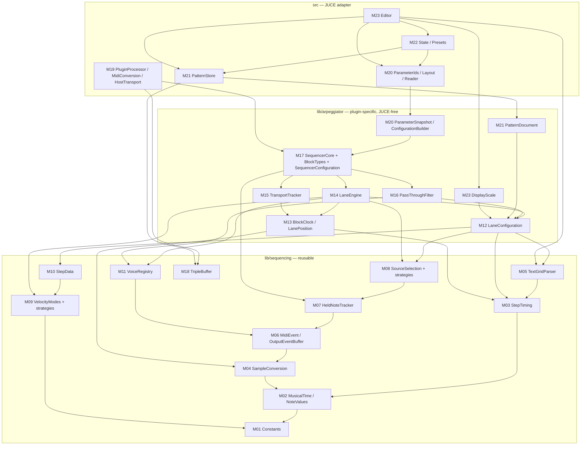

# phu-sequential — Architecture — 01-layers-and-dependencies.md

## 1. Layers, directories, namespaces, targets

### 1.1 Layers (§16.1, §16.5, §19) — D-1

| Layer | Directory | Namespace | JUCE? | Content |
|---|---|---|---|---|
| Reusable core | `lib/sequencing/` | `phu::sequencing` | no | constants, musical time, note values, step timing, sample conversion, text-grid parser, MIDI event types, held notes/chord, source strategies, velocity strategies, step data, voice registry, triple buffer |
| Plugin-specific core | `lib/arpeggiator/` | `phu::arpeggiator` | no | lane configuration, lane position, lane engine, transport tracker, pass-through filter, block I/O, sequencer configuration, `SequencerCore`, parameter snapshot → configuration, pattern document, display scale |
| JUCE adapter | `src/` (+ `src/editor/`) | `phu::plugin` (`phu::plugin::editor`) | yes | `AudioProcessor`, MIDI conversion, host transport, parameter layout/reader, pattern store, state/presets, editor |
| Tests | `tests/core/`, `tests/adapter/`, `tests/support/` | `phu::tests` | core: no; adapter: yes | Catch2 v3 |

Dependency rules (enforced by review, and by CMake: `SequentialCoreLib` does not link JUCE):

- `sequencing` depends on nothing but the C++20 standard library.
- `arpeggiator` depends on `sequencing` only.
- `plugin` depends on `arpeggiator`, `sequencing`, JUCE.
- Nothing in `lib/` includes a JUCE header, throws on an [RT] path, uses globals/singletons with mutable state, reads clocks, or uses randomness (§18). The spec contains no random behavior; if any is ever added, it takes an injected, seeded generator.

D-2: `SequentialCoreLib` is a **STATIC** library with `.h/.cpp` pairs (one unit per file, §19), deviating from the template's header-only INTERFACE library because the core is larger and compile times matter. Pure data/constexpr units may be header-only.

### 1.2 Directory layout

```
CMakeLists.txt                      # root (#4)
CMakePresets.json                   # (#4)
cmake/PhuDependencies.cmake         # phu_fetch_juce, phu_fetch_catch2 (#4)
cmake/compiler_flags.cmake          # ENABLE_STRICT_WARNINGS / ENABLE_SANITIZERS / ENABLE_COVERAGE (#4)
cmake/juce_config.cmake             # JUCE feature flags (#4)
scripts/install-linux-deps.sh, scripts/find-cmake.ps1   (#4)
lib/CMakeLists.txt                  # target SequentialCoreLib (#4 creates, later issues add sources)
lib/sequencing/
  Constants.h                       M01 (#5)
  MusicalTime.h                     M02 (#5)
  NoteValues.h                      M02 (#5)
  StepTiming.h / .cpp               M03 (#5)
  SampleConversion.h                M04 (#5)
  TextGridParser.h / .cpp           M05 (#6)
  MidiEvent.h                       M06 (#7)
  OutputEventBuffer.h / .cpp        M06 (#9)
  HeldNoteTracker.h / .cpp          M07 (#7)
  sources/SourceSelection.h / .cpp  M08 (#7)  types, classification, registry lookup
  sources/ChordFollowSource.h/.cpp  M08 (#7)  strategy unit
  sources/ChannelSource.h / .cpp    M08 (#7)  strategy unit
  sources/InputModeRegistry.h       M08 (#7)  the one registration place
  velocity/VelocityMode.h           M09 (#8)  enum + definition type
  velocity/IncomingVelocity.h       M09 (#8)  strategy unit
  velocity/ByStepVelocity.h         M09 (#8)
  velocity/DeltaByStepVelocity.h    M09 (#8)
  velocity/RelativeVelocity.h       M09 (#8)
  velocity/VelocityModeRegistry.h / .cpp  M09 (#8)  the one registration place
  StepData.h / .cpp                 M10 (#8)
  VoiceRegistry.h / .cpp            M11 (#9)
  TripleBuffer.h                    M18 (#12)
lib/arpeggiator/
  LaneConfiguration.h / .cpp        M12 (#10)
  BlockClock.h                      M13 (#10)
  LanePosition.h / .cpp             M13 (#10)
  LaneEngine.h / .cpp               M14 (#10)
  TransportTracker.h / .cpp         M15 (#11)
  PassThroughFilter.h / .cpp        M16 (#11)
  BlockTypes.h                      M17 (#11)
  SequencerConfiguration.h / .cpp   M17 (#11)
  SequencerCore.h / .cpp            M17 (#11)
  ParameterSnapshot.h               M20 (#13)
  ConfigurationBuilder.h / .cpp     M20 (#13)
  PatternDocument.h / .cpp          M21 (#14)
  DisplayScale.h / .cpp             M23 (#15)
src/CMakeLists.txt                  # plugin target phu-sequential (#4)
src/
  PluginProcessor.h / .cpp          M19 (#12)
  MidiConversion.h / .cpp           M19 (#12)
  HostTransport.h / .cpp            M19 (#12)
  PlaybackStatus.h                  M19 (#12)
  ParameterIds.h / .cpp             M20 (#13)
  ParameterLayout.h / .cpp          M20 (#13)
  ParameterReader.h / .cpp          M20 (#13)
  PatternStore.h / .cpp             M21 (#14)
  StateSerializer.h / .cpp          M22 (#14)
  StateMigration.h / .cpp           M22 (#14)
  PresetManager.h / .cpp            M22 (#14)
  editor/PluginEditor.h / .cpp      M23 (#15)
  editor/GlobalBar.h / .cpp         M23 (#15)
  editor/LaneRow.h / .cpp           M23 (#15)
  editor/LaneControlStrip.h / .cpp  M23 (#15)
  editor/StepDisplay.h / .cpp       M23 (#15)
  editor/TextGridField.h / .cpp     M23 (#15)
  editor/LaneColorPicker.h / .cpp   M23 (#15)
  editor/EditorLookAndFeel.h / .cpp M23 (#15)
presets/factory/*.phuseq            M24 (#16)
tests/CMakeLists.txt                # SequentialCoreTests (#4), SequentialAdapterTests (#12)
tests/support/AllocationGuard.h / .cpp   (#11) counts global operator new during a scope
tests/support/ScenarioRunner.h / .cpp    (#11) drives SequencerCore with scripted blocks
tests/core/<Module>Tests.cpp        # one file per module, e.g. StepTimingTests.cpp
tests/adapter/<Unit>Tests.cpp       # MidiConversionTests.cpp, ParameterLayoutTests.cpp, StateSerializerTests.cpp, ...
docs/architecture.md, docs/test-matrix.md (#3), docs/ui/*
```

Include style (template convention): include directory is `lib/`, so `#include "sequencing/StepTiming.h"`, `#include "arpeggiator/LaneEngine.h"`. `src/` files include `"PluginProcessor.h"` relative to `src/`.

### 1.3 Module dependency graph



---

