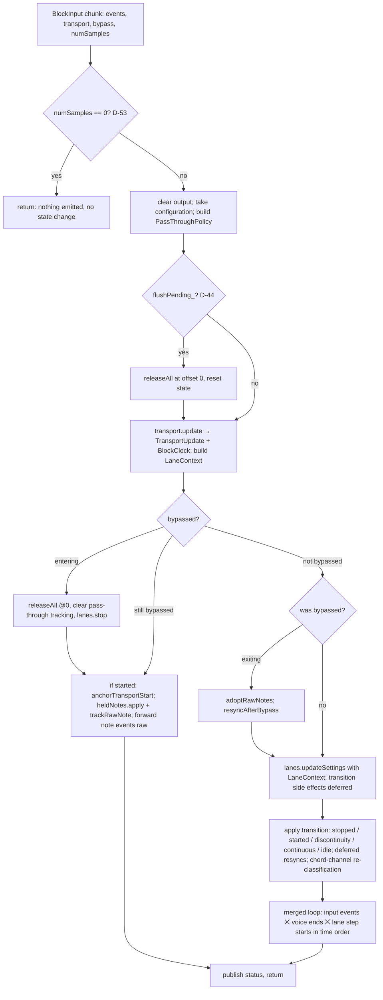

# phu-sequential — Architecture — 05-per-block-flow.md

## 5. Per-block processing flow (`SequencerCore::processBlock`)

### 5.1 Overview

### 5.2 Algorithm (normative)

Let `n = numSamples` (of this chunk), `cfg = clampConfiguration(configuration)`. All steps below refer to one core call (one chunk, D-51); "block start" = offset 0 of the call.

0. If `n == 0`: return immediately — nothing is emitted, no state changes (flush, bypass edge, transport expectation, pending Note-Offs and transitions all stay pending for the next non-empty call; D-53). Otherwise: `output.clear()`; `configuration_ = cfg`; `policy = makePassThroughPolicy(cfg.global, cfg.lanes)`. If `flushPending_`: `voices_.releaseAll(0)`, `voices_.reset()`, `passThrough_.reset()`, `heldNotes_.reset()`, `transport_.reset()`, lanes `reset()`; `flushPending_ = false` (D-44; `reset()` itself cannot emit, so the Note-Offs leave with the first non-empty block after prepare).
1. **Transport and clock** (always first, D-14 order fix): `update = transport_.update(transport, sampleRate, n, advanceExpectation = !moreInputAtSameOffset)`; `clock = update.clock`; build `ctx = LaneContext{voices_, output, heldNotes_, clock, cfg.global.chordInputChannel}`. No transition side effect is executed yet.
2. **Bypass** (§21, D-27):
   - `bypassed && !wasBypassed_` (enter): `voices_.releaseAll(0)` (lane and passed-through notes, oldest first), `passThrough_.clearTracking()`, every lane `stop(ctx)` (clears latch memory, §4.6).
   - `bypassed`: if `update.transition == started`, every lane `anchorTransportStart(clock.blockStartBeat)` (phase offset follows transport start even while bypassed, §21 "resume … without reset"). For each input event in order: `e = normalizeNoteEvent(ev)`; `heldNotes_.apply(e)`; `passThrough_.trackRawNote(e)`; if `ev` is a note event, push it unchanged (raw, §21; CC64 and all non-note events are copied by the adapter, D-31). `wasBypassed_ = true`; go to 6.
   - `!bypassed && wasBypassed_` (exit): `passThrough_.adoptRawNotes(voices_)`; `wasBypassed_ = false`; `resyncAfterBypass = true`.
3. **Settings**: every lane `updateSettings(cfg.lanes[i], patterns_.lanes[i], ctx)` (change classes §4.1 of this doc; immediate releases at offset 0; `resynchronize` is never called here, only requested, D-9).
4. **Transitions** (in this order):
   1. `stopped`: `voices_.releaseAll(0)` (lane **and** pass-through voices, oldest first), `passThrough_.clearTracking()`, every lane `stop(ctx)` (pending committed, latch cleared; §10 "all sounding notes", §4.6, D-17, D-18).
   2. `started`: lanes `startTransport(clock.blockStartBeat)` (§10: phase offset = playhead; step 0 at the playhead, D-4).
   3. `discontinuity`: `voices_.releaseAll(0)`, `passThrough_.clearTracking()` (D-17), then lanes `resynchronize(clock.blockStartBeat, 0, releaseVoices = false)` (§10, D-19).
   4. `continuous`: lanes with `resyncAfterBypass` or `resynchronizeRequested()`: `resynchronize(clock.windowStartBeat, 0, releaseVoices = false)` (voices were already flushed on bypass enter; D-9). For `started`/`stopped`/`discontinuity` the transition itself has cleared the request.
   5. If the chord input channel changed and the transport is playing: every lane `onHeldNotesChanged(0)` (D-24) — after 4.1–4.4 so the lanes see their post-transition state.
   6. `idle`, `stopped`: skip step 5's timeline part (only input events are processed, all at their offsets).
5. **Merged loop** (timeline items only if playing; input events always): repeat
   - `tv = voices_.nextScheduledEnd()` (beat, O(1), M11), `tl = min_i lanes_[i].nextTimelineBeat()` (lowest lane index on tie);
   - **Same-offset pieces** (`moreInputAtSameOffset`, D-51): lane step starts are suppressed in this call, so the timeline candidate is computed from voice ends **only**: `tItem = tv`, and the item exists iff `tv < clock.windowEndBeat` and `clock.toSampleOffset(tv) == 0`. `tl` is not consulted, so a suppressed (possibly earlier) lane start can never hide or block a due voice end. Lane step starts and all items with `sItem > 0` stay pending for the next call;
   - **Otherwise** (final piece / regular chunk): `tItem = min(tv, tl)`; the timeline item exists iff `tItem < clock.windowEndBeat`; its sample `sItem = clock.toSampleOffset(tItem)`;
   - next input event `e` (if any) is processed first iff no timeline item exists, or `e.sampleOffset < sItem`, or (`e.sampleOffset == sItem` and the timeline item is a lane event) — see 5.3;
   - **input event**: `e' = normalizeNoteEvent(e)`; `changed = heldNotes_.apply(e')`; `passThrough_.process(e', policy, voices_, output)`; if `changed` (note events, CC64) and playing: every lane `onHeldNotesChanged(e.sampleOffset)`;
   - **voice end** (item is a voice end, i.e. `tv <= tl`, or always in a same-offset piece): `voices_.endVoice(handle, sItem, output)`;
   - **lane event**: `lanes_[i].processNextTimelineEvent(ctx)` (one step start: commits, then trigger; events at `clock.toSampleOffset(beat)`);
   - stop when inputs are exhausted and no timeline item exists.
   Items with `beat < windowStartBeat` cannot exist (lanes and registry are only scheduled forward; a swung step start is scheduled at the preceding step start, which is earlier, D-4/D-50); items exactly at `windowStartBeat` are inside the window.
6. Publish: `PlaybackStatus` from lanes' `status()`; `BlockResult.discardStateChanged` if any lane's discard revision or mask changed (D-32); dropped event count.

Bound per core call (chunk ≤ `samplesPerChunk` = 4096 samples, ≤ 4096 input events): each lane processes ≤ (step starts in the window) items, each emitting ≤ 3 events (retrigger Off, eviction Off, On); voice ends ≤ starts + 2048; input ≤ 4096 events → ≤ 2 output events each; block-start releases ≤ 2048. With the shortest step (1/64 triplet = 1/24 beat) at 999 BPM, 48 kHz, 4096 samples ≈ 34 step starts per lane: ≤ 2048 + 8192 + 8·34·3 + (8·34 + 2048) = 13 376 ≤ 14 336 = 16384 − `noteOffReserveEvents` (2048), so even core Note-Ons are never refused; Note-Offs additionally own the 2048 reserved slots (M06 partition, D-30), so no core output event is ever dropped.

### 5.3 Ordering rules for equal times (D-14)

Within a block, output order = processing order. For events landing on the same sample offset:

1. Block-start actions at offset 0 (flush D-44, bypass enter, settings changes that release voices, stop/discontinuity release) come before everything else, in the step order of 5.2.
2. At equal **beat**: voice ends (Note-Off) before lane events; lane events of lower lane index first; within one lane's step start: commits (with their releases) before the trigger. Thus a note ending exactly where the next note of the same pitch starts produces Note-Off then Note-On (§9.1 retrigger is then not needed).
3. Different beats mapping to the same sample keep beat order.
4. Input event vs timeline item at the same sample offset: input event first if the item is a lane event (a key pressed at a step start is already visible to that trigger; a key released at a step start is not used, §4.4); timeline Note-Off first if the item is a voice end (ends free their slot before pass-through Note-Ons on the same key).
5. Inside `startVoice`: retrigger Note-Off → limit eviction Note-Off → Note-On (D-29).
6. A note whose gated end maps to the same sample as its start (very short gate at very high tempo) is emitted Note-On then Note-Off at the same offset (D-40); hosts preserve insertion order.
7. Input events keep their relative order (stable), also across chunks and same-offset pieces (D-51).
8. Adapter merge (D-31): non-note input events (copied raw by the adapter) precede all core output at the same sample offset; JUCE `MidiBuffer::addEvent` inserts after existing events of the same sample, and the raw events are added first.

### 5.4 Sample offsets and block boundaries

- The core works in beats; `BlockClock::toSampleOffset` (M04, D-15) is the only conversion: `floor((beat − blockStartBeat)·samplesPerBeat + 1e-6)`, clamped to `[0, n−1]`. Tempo is constant within the block (§10: tempo changes take effect from the next block automatically because samplesPerBeat is recomputed per block; the beat-based schedule is never rescaled).
- Window `[windowStartBeat, windowEndBeat)` half-open: an event at exactly `windowEndBeat` belongs to the next block. Continuous playback (D-16): `windowStartBeat` = previous `windowEndBeat` even if the host reports a slightly different playhead (≤ 1 sample backward, ≤ 1 block forward); items between the expected and reported start are emitted at offset 0 (late by < 1 sample backwards drift / clamped). Nothing is lost or duplicated at block boundaries.
- Scheduled lane Note-Offs and step starts lying in future blocks stay pending as beats in the registry/lane; they are emitted when their beat enters a window. A swung step start `e_k` that lies before the grid start `g_k` is simply emitted in whichever block contains `e_k` (it may be the block that also contains the end of step k−1).
- `numSamples == 0` (D-53): the core returns without emitting or changing state; flushes, bypass edges, transport transitions and due Note-Offs are handled by the next non-empty call (their beats are then ≤ the window start and are emitted at offset 0). The adapter never calls the core with `n == 0` and emits nothing for such a host block (§6.1).
- Input events with offsets outside `[0, n−1]` are clamped by the adapter (M19) before the core.

---

